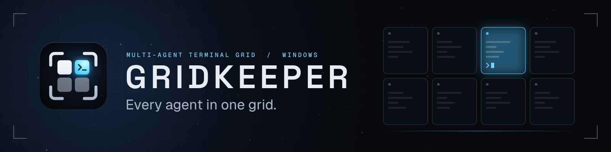
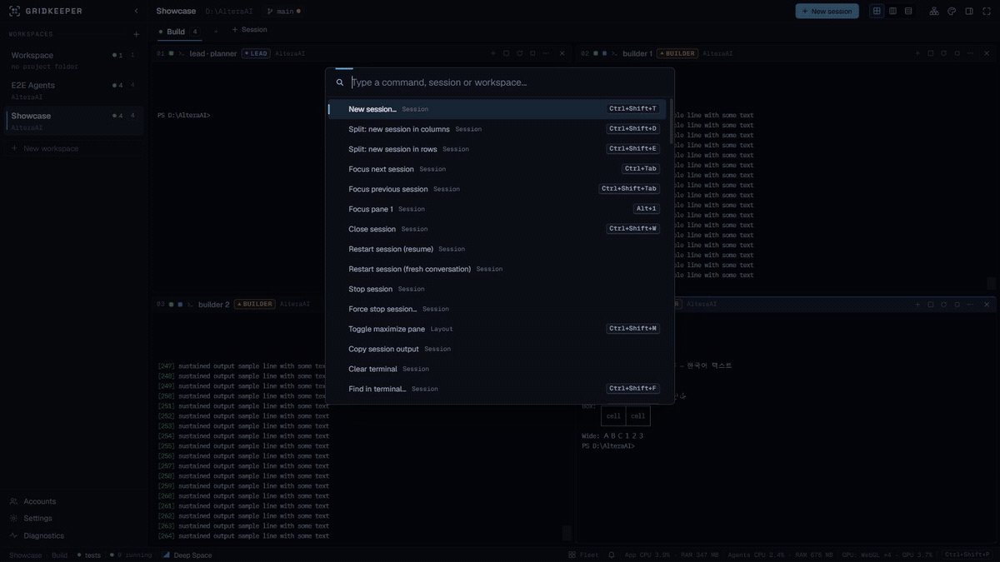
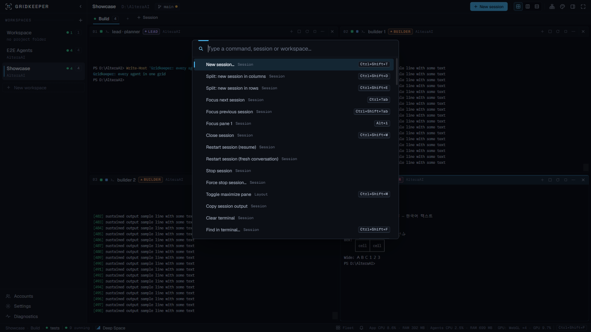
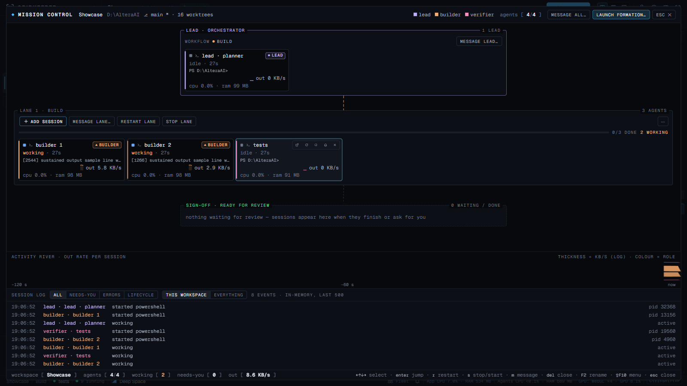
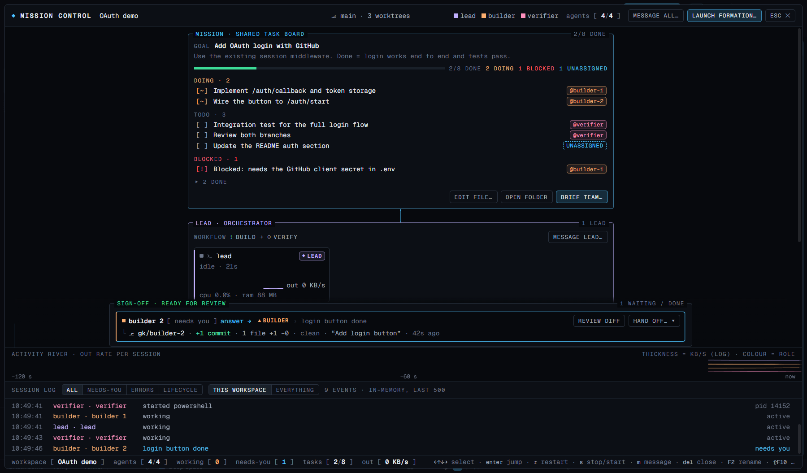
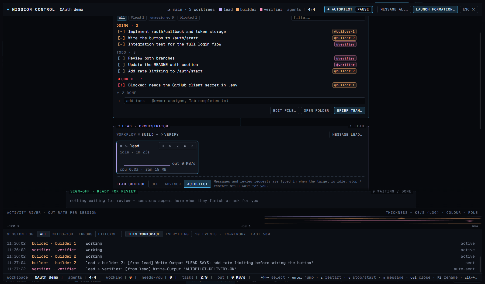
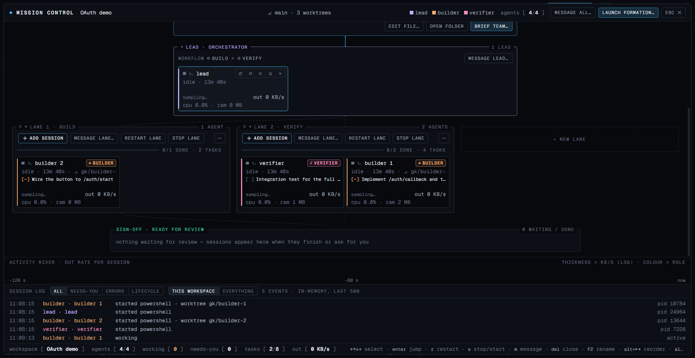
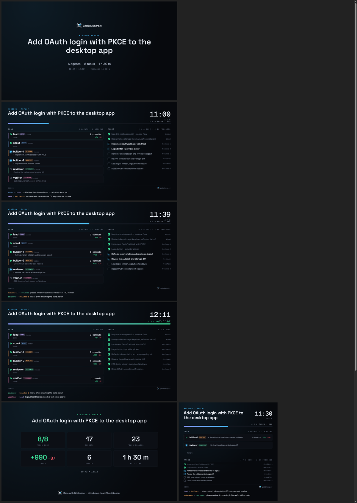
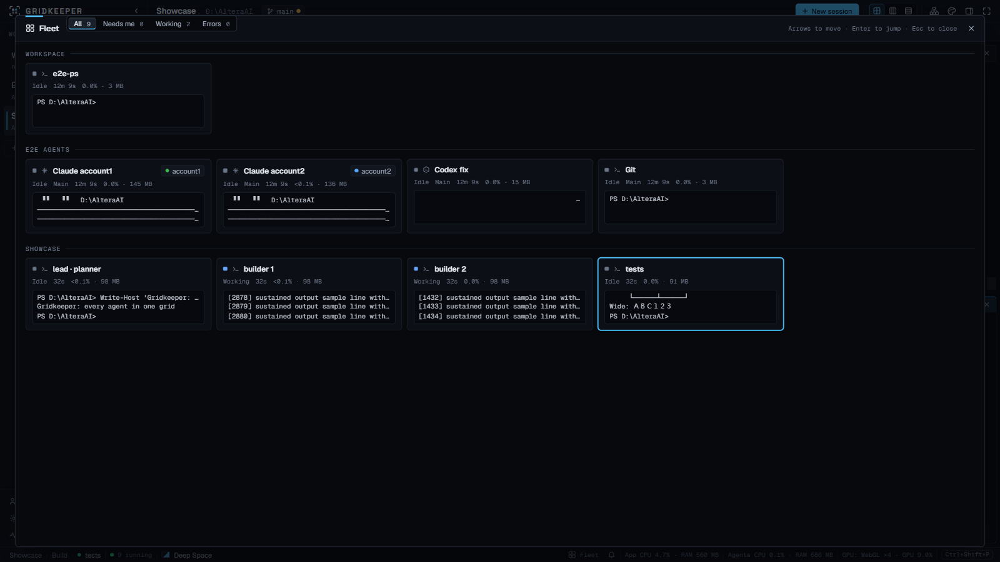
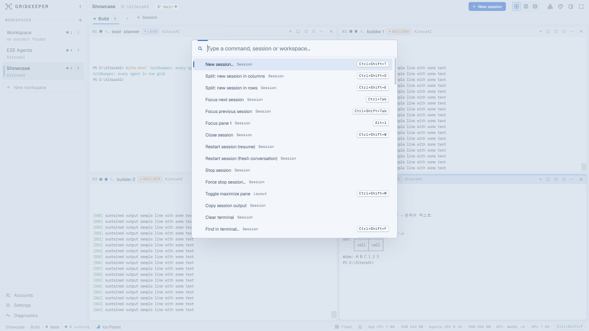

<p align="center">
  
</p>

<p align="center">
  <a href="https://github.com/raazi29/gridkeeper/releases/latest"></a>
  
  <a href="https://ci.appveyor.com/project/raazi29/gridkeeper"></a>
  <a href="LICENSE"></a>
  
  
  
  
</p>

<p align="center">
  <b>Every agent in one grid.</b> A GPU-accelerated workspace for running a whole team of AI coding agents
  (Claude Code with several accounts at once, Codex, Hermes, OpenCode, Aider and plain shells) side by side:
  a shared task board they update themselves, a lead that coordinates them under your rules, a keeper that tells
  you which one needs you, and a replay video of the mission when it's done. Windows-native, macOS and Linux in preview.
</p>

<p align="center">
  <a href="#mission-one-markdown-file-a-whole-agent-team">Mission</a> ·
  <a href="#install">Install</a> ·
  <a href="#quick-start">Quick start</a> ·
  <a href="#features">Features</a> ·
  <a href="#keybindings">Keybindings</a> ·
  <a href="#documentation">Docs</a> ·
  <a href="CONTRIBUTING.md">Contributing</a>
</p>

<p align="center">
  
</p>

<p align="center">
  
  <br/><sub>Recorded from the real app (31 s). Full-quality video: <a href="docs/assets/showcase/gridkeeper-demo.mp4">gridkeeper-demo.mp4</a></sub>
</p>

| Live agent grid | Mission Control |
|---|---|
|  |  |
| **Mission board: the team's shared task list, live** | **Lead control on autopilot** |
|  |  |
| **Drag agents between lanes, collapse, add lanes** | **Mission replay: a shareable timelapse** |
|  |  |
| **Fleet: every session at a glance** | **Command palette (Ice Planet light theme)** |
|  |  |

<p align="center"></p>

## Mission: one Markdown file, a whole agent team

Give the team a goal. The lead writes tasks into `.gridkeeper/mission.md`, builders claim them (`[~]`) and tick them
off (`[x]`), reviewers sign off. Gridkeeper's Mission Control renders the board live, shows who is on what, and puts
each finished branch's evidence (commits, files, lines) next to a *Review diff* button.

```markdown
# Mission: Add OAuth login with GitHub

## Tasks
- [x] Plan the auth flow and split the work @lead
- [~] Implement /auth/callback and token storage @builder-1
- [~] Wire the button to /auth/start @builder-2
- [!] Blocked: needs the GitHub client secret in .env @builder-1
- [ ] Review both branches @verifier
```

**Use the protocol with any agent, on any OS, even without Gridkeeper.** It ships as an Agent Skill:

```bash
# Claude Code
/plugin marketplace add raazi29/gridkeeper
/plugin install agent-mission@gridkeeper

# any Agent Skills host (Claude Code, Codex, Gemini CLI, Cursor, ...)
npx skills add raazi29/gridkeeper
```

Then tell one agent "start a mission: …" and the others "join the mission". See [`skills/agent-mission/SKILL.md`](skills/agent-mission/SKILL.md).

### The lead runs the team, as much as you allow

Give a session the **lead** role (drag its card onto the lead box) and choose, per project, how much it may do:

| Mode | What happens |
|---|---|
| **Off** | The lead is just a label. |
| **Advisor** | The lead reads `.gridkeeper/team.md` (every member's state, task, branch and diff stats, kept current by Gridkeeper) and writes instructions as files in `.gridkeeper/outbox/`. Each one shows up in Mission Control as a proposal you **Send**, edit or dismiss. |
| **Autopilot** | Instructions are typed into the target automatically, but only while it is idle and not asking anything (never into a permission prompt), at most one per agent every 20 s. `stop` / `restart` always wait for you. One click pauses it, also from the status bar. |

With **auto-review** on, an agent that finishes work on its branch triggers a review request to the lead
("builder-1 finished … review with `git diff main...gk/builder-1`"), so the lead checks the work like an advisor
before you merge.

### Mission Control does the busywork

- **Drag and drop:** move agents between lanes, drop one on the lead box to make it the lead, drag lanes to reorder phases, drop on *new lane*. Drag tasks between *doing / todo / blocked / done*, reorder them, or drop a task on an agent to assign it. Keyboard alternatives for all of it (`Alt+arrows`).
- **Edit the plan in place:** quick-add tasks (`n`, Tab completes `@owners`), double-click to edit, assign from a menu, delete with Undo, filter by agent / unassigned / blocked. Edits are conflict-checked against what agents write.
- **Brief the team** in one dialog (a role-specific line per agent; agents that are asking you something are skipped) and **hand off** finished work to the reviewer with the exact branch and diff command.
- **Sign-off with evidence:** commits ahead, files and lines changed, uncommitted leftovers and the last commit; *Review diff* opens the branch's committed changes file by file.
- **A canvas you can zoom and pan:** `Ctrl+wheel` or pinch zooms (25–200 %), the wheel, `Space`+drag or a drag on empty canvas pans, `F` fits. A minimap (`Shift+M`, off by default) shows boxes and cards by state.
- **Four views** (`1`–`4`): the graph, a board of tasks per agent or per lane, a timeline of each agent's state over time with task and message markers, and a sortable list.
- **Find and focus:** `Ctrl+F` over agents and tasks, role and state filter chips, spotlight a lane or agent, pin cards (`P`) to the top of their lane.
- **Bulk actions:** select several agents (Ctrl/Shift+click, `Shift`+drag) and message, restart, stop, move or assign them in one go, through the usual confirmations. An agent side panel shows state, tasks, branch evidence, usage, CPU / RAM and the last output lines.
- **Motion you can turn off:** messages travel as small animations along the links, moved cards glide, and an optional effects layer adds a briefing crawl; all of it follows *Reduce motion*.

### Brain: project memory that outlives the session

`.gridkeeper/brain/` holds the team's long-term memory as plain Markdown: one note per file in `notes/` (a decision,
convention, gotcha, how-to, fact or context, with tags and a source), suggestions waiting for you in `inbox/`, and an
`INDEX.md` that Gridkeeper regenerates from the notes. Briefs and formation starter prompts tell agents to read
`INDEX.md` first and to suggest new memories in `inbox/`. Gridkeeper also suggests some itself from the mission board
(finished tasks with `- note:` lines, approved reviews, resolved blockers) and from lead decisions; nothing becomes
a note until you approve it, unless you turn on auto-approve for the project. The Brain panel (palette or the
*brain* button in Mission Control) searches, filters, edits, supersedes and forgets notes, with Undo. Notes are local
by default; sharing them through git (Brain panel settings) adds a marked `.gitignore` block so `notes/` and `INDEX.md` can be committed, while
the inbox stays local. The format is documented in the `agent-mission` skill, so agents can keep it up without
Gridkeeper.

### Test runs and the merge assistant

*Run tests* on an agent card, a sign-off card, a lane or the session menu runs the project's test command in that
agent's worktree, in the background, contained like any session (the whole process tree ends on cancel, time limit or
finish). The command is detected from `package.json`, `Cargo.toml`, pytest config, `go.mod` or a Makefile, or set per
workspace and per lane. Cards show the result (`tests ✓ 412 · 38s`, `tests ✗ 3 failed`), pinned to the commit that
was tested; a failure can be handed back to the agent after you confirm the message.

*merge…* on a sign-off card is Gridkeeper's first git write operation, and it is deliberately cautious. The preview
writes nothing: commits, diffstat and conflicts (via `git merge-tree`). The merge runs in the main checkout as a
fast-forward, merge commit or squash of exactly the previewed commit, and is refused, with a reason, when that checkout
has another branch, local changes or an operation in progress, or when either branch moved since the preview.
An optional gate requires a passing test run on that commit. The dialog shows the exact git commands; a failed step
is rolled back (`merge --abort`, or `reset --merge` after a squash) and checked. Removing the worktree and branch afterwards is a separate confirmation (never
`--force`, `branch -d` only when merged). See ADR-022 and ADR-023 in [docs/TECHNICAL_DECISIONS.md](docs/TECHNICAL_DECISIONS.md).

### Mission replay: share what your agents did

Every mission is recorded as events only (task changes, agent states, commits, lead messages; never terminal
output, paths or e-mails). *Replay…* turns it into a 15–60 s timelapse at 1920×1080, 1080×1080 or 1080×1920 and
exports **MP4 / WebM** or a **GIF**, rendered inside the app with no ffmpeg. The end card shows tasks done, commits,
lines changed, agents and wall time.

### Mission recap: a video of any agent session, without Gridkeeper

The same install (`/plugin install agent-mission@gridkeeper` or `npx skills add raazi29/gridkeeper`) adds a second
skill, [`mission-recap`](skills/mission-recap/SKILL.md). Ask any agent (Claude Code,
Codex, Gemini CLI, Cursor, ...) to "make a recap video of what we did": it runs a Node script (no dependencies) that
reads git history, one lane per branch or worktree, plus the mission board, and writes one offline HTML page with the
same renderer. Preview it, then export MP4 or GIF in the browser, or headless with `--mp4` / `--gif`. Only branch
names, counts, times and path-free commit subjects go in; no file contents, paths or e-mails.

```bash
node skills/mission-recap/scripts/recap.mjs --since "yesterday" --goal "Add OAuth login" --aspect vertical --mp4
```

### Skills: add trending agent skills to your project

*Skills: discover & add…* (command palette) lists trending and top Agent Skills on GitHub, or any repo you paste.
Read the SKILL.md and every file first (scripts are flagged), then add it to the project's `.claude/skills` and/or
`.agents/skills` so every agent in the workspace gets it. Each skill is pinned to a commit and can be checked for
updates or removed. Network requests happen only when you use the panel, and Gridkeeper never runs anything a skill
contains.

### Team templates

Launch formation › *Templates* exports a team as one `.gridkeeper-team.json` file (groups, roles, agents, starter
prompts, starter tasks, a recommended lead mode) or imports one, with a preview of every session, worktree command
and prompt before anything starts. Import drops account ids, arguments, environment variables, absolute paths and
recognised secret formats, and accepts only built-in agents and catalog presets. Six built-in templates (feature
squad, bug bash, refactor with a safety net, docs sprint, security review, solo + reviewer) are in the gallery.
Schema and rules: [docs/team-templates.md](docs/team-templates.md).

### Flight log

A local record of mission work: a streak of days with at least one completed mission task (with shields that cover a
missed day), ranks by total tasks, medals, and totals for tasks, missions, commits and agents. It lives in the
Mission Control header, keeps only counts and hashes, and can be turned off or reset in Settings › Interface.

### Cost & context meter (Claude Code)

Turn it on in Settings › Agents and each Claude pane shows `$0.42 · 37%`: Claude Code's own cost estimate and how
full the context window is (amber from 80 %). Mission Control totals the workspace. Gridkeeper reads only the
documented status-line fields (no transcripts, no credentials) and your own status line keeps working. Codex and
Gemini CLI don't report usage to other programs, so they show "n/a".

**Exact status from hooks.** With the meter on, the same per-pane `--settings` file also adds Claude Code hooks
(*Exact status for Claude panes*, on by default). Claude Code merges them with your own hooks, which keep running
unchanged and are never read. Panes then show exactly when Claude needs permission (with the tool name), asks a
question, runs a tool or has finished, instead of inferring it from terminal output, and Autopilot and hand-offs
never type into a permission or question prompt. Gridkeeper keeps only the event, tool name, notification type and
session id.

**Daily spend guard.** A budget per workspace, counted from local midnight over the meter's numbers. A toast warns at
the share you set; at 100 % it warns, pauses that project's Autopilot, or pauses and sends an OS notification, and a
banner offers *Raise budget* / *Resume*. Agents are never stopped. Amounts are Claude Code's estimate
(API-equivalent on a subscription).

### Phone alerts (ntfy)

Opt-in, in Settings › Notifications: a short, generic push to your phone through [ntfy](https://ntfy.sh) (the public
server or your own) when an agent needs input, hits an error, a lead proposal waits for you, a mission is done or, if you choose, a pane finishes.
Never terminal output; pane and workspace names only if you allow them. One HTTPS request per alert, at most one per
pane every 2 minutes and 10 per hour, no retries. Do not disturb, mutes and phone quiet hours apply. Settings shows
a QR code to subscribe; the optional access token is kept in Windows Credential Manager (a 0600 file elsewhere).

### Native browser panes (Windows)

On Windows each browser pane is a real WebView2 view of its own (a Tauri child webview laid over the pane), so sites
that refuse embedding, such as GitHub and sign-in pages, work in the grid, with in-page history, real titles,
new-window links (opened in a new pane or the same one) and downloads. App shortcuts keep working while a page has
focus. When a menu or dialog covers a pane, it shows a still picture of the page. *Browser engine* in Settings ›
Interface switches back to the sandboxed iframe engine (*Embedded frame (legacy)*), which is also what macOS and Linux
use. See ADR-021.

### Agent browser

Tick *Give this agent a browser* in the New session dialog (or session menu › *Agent browser* on a Claude Code or Codex
pane, then restart it) and the agent gets browser tools for a tab of its own: open the app you are building, read the
page, click, type, check console and network errors, take screenshots. All agents share **one** headless Edge or
Chrome with its own profile in Gridkeeper's data folder, so ten agents don't mean ten browsers. The browser starts on
the first tool call and closes after 10 idle minutes. *Agent browser* (command palette) shows every agent's tab live;
*Take over* gives you the mouse and keyboard while the agent's calls wait, *Stop agent browsing* closes its tab.

Gridkeeper adds the tools for that one process (`--mcp-config` for Claude Code, `-c mcp_servers…` for Codex); your
own MCP servers and config files are untouched, and no Node is needed. The browser is driven over a pipe, not a
debugging port, and each agent can only reach its own tab. Submitting a form or running a script outside localhost
(and an allowlist you control), every upload and every download wait for your OK; every action lands in the session
log. Pages can contain prompt injections, so keep personal logins out of this browser.

## Features

<table>
<tr>
<td width="33%" valign="top">🧩 <b>Agent grid</b><br/>Workspaces → groups → panes in a grid, columns or rows. Resizable splits, drag to reorder, maximize any pane.</td>
<td width="33%" valign="top">👥 <b>Many accounts, truly separate</b><br/>Several Claude Code, Codex and Hermes logins side by side, one isolated home folder per account. Credentials are never read.</td>
<td width="33%" valign="top">🛰️ <b>Mission Control &amp; Formations</b><br/>A shared task board your agents read and update, a zoomable live team view (lead, lanes, sign-off with git evidence; graph, board, timeline and list views) and one-click agent teams with their own worktrees.</td>
</tr>
<tr>
<td valign="top">🔔 <b>Knows when an agent needs you</b><br/>Attention lamps, unread badges, Windows notifications, a Comms feed; exact Claude Code status from hooks. <code>Ctrl+Shift+J</code> jumps to the next alert.</td>
<td valign="top">🚀 <b>Fleet &amp; Broadcast</b><br/>Every session in every workspace as live tiles; type once and send to several agents (always with confirmation).</td>
<td valign="top">🌐 <b>Browser panes, ports &amp; agent browser</b><br/>Preview dev servers next to the terminals (native WebView2 panes on Windows). A <code>:5173</code> chip opens a detected port. Agents can get a browser tab of their own.</td>
</tr>
<tr>
<td valign="top">🔀 <b>Changes drawer</b><br/>Branch, ahead/behind and coloured diffs for the workspace and every worktree. Read-only by design.</td>
<td valign="top">⚡ <b>Built not to burn CPU</b><br/>Idle at ≈0.1–0.4 % of the machine. WebGL rendering, raw binary IPC, no polling while idle.</td>
<td valign="top">🛡️ <b>No orphans</b><br/>Each agent's whole process tree lives in a Windows Job Object: quit, close or crash, nothing is left running. (macOS/Linux: every agent stops on quit; a hard crash can leave them running.)</td>
</tr>
<tr>
<td valign="top">🎨 <b>12 themes</b><br/>Deep Space, Twin Suns, Carbonite, Ice Planet, Hyperspace, Holo Comms, Saber Duel, Outer Rim and more. All are WCAG contrast-tested.</td>
<td valign="top">♻️ <b>Restore that resumes</b><br/>Layouts always come back; each Claude pane resumes its own pinned conversation; Codex and catalog agents continue where they can.</td>
<td valign="top">🔒 <b>Local-first</b><br/>No telemetry, no cloud backend, no local HTTP server. Secrets are redacted from logs and exports.</td>
</tr>
<tr>
<td valign="top">🧠 <b>A lead that runs the team</b><br/>Off, Advisor (you approve every instruction) or Autopilot (delivered to idle agents only), plus auto-review of finished branches.</td>
<td valign="top">🎬 <b>Mission replay</b><br/>Turn a mission into a 15–60 s timelapse video or GIF to share. Rendered in the app, events only.</td>
<td valign="top">🧰 <b>Skills panel</b><br/>Find trending Agent Skills, review every file, add them to the project pinned to a commit.</td>
</tr>
<tr>
<td valign="top">💰 <b>Cost meter &amp; spend guard</b><br/>Claude Code's cost estimate and context fill per pane and per workspace, from documented status-line data only, plus an optional daily budget per workspace.</td>
<td valign="top">🖐️ <b>Drag and drop everywhere</b><br/>Agents between lanes, lanes into phases, tasks between states and onto agents. All with keyboard alternatives.</td>
<td valign="top">🍎 <b>macOS &amp; Linux (preview)</b><br/>Same app on your login shell, ⌘ shortcuts on macOS, built and tested in CI on all three systems.</td>
</tr>
<tr>
<td valign="top">📚 <b>Brain</b><br/>Long-term project memory in <code>.gridkeeper/brain/</code>: Markdown notes, suggestions you approve, a generated index, search, optional sharing through git.</td>
<td valign="top">✅ <b>Test runs &amp; merge assistant</b><br/>Contained test runs per agent or lane, results pinned to a commit; a previewed, guarded merge with rollback and worktree clean-up.</td>
<td valign="top">📋 <b>Team templates</b><br/>Export and import a team as <code>.gridkeeper-team.json</code>, sanitized on import, or start from six built-in templates.</td>
</tr>
<tr>
<td valign="top">📱 <b>Phone alerts</b><br/>Opt-in pushes through ntfy with generic text, rate-limited, respecting Do not disturb and quiet hours.</td>
<td valign="top">🏅 <b>Flight log</b><br/>A local streak, ranks and medals from completed mission tasks. Counts only, can be turned off.</td>
<td valign="top">🌍 <b>12 languages</b><br/>Including right-to-left Arabic. Follows the system language or a choice in Settings.</td>
</tr>
</table>

Works with **Claude Code, Codex, PowerShell** and, when installed, **Hermes, OpenCode, Gemini CLI, Copilot CLI, Aider,
Factory Droid, Kimi, Qwen Code, Cursor Agent, Goose, Crush, Amp and OpenClaw**, plus any other command-line program.

### Languages

English, Español, Português (Brasil), Français, Deutsch, 日本語, 简体中文, 한국어, हिन्दी, Русский, العربية
(right-to-left) and Türkçe: Settings › Interface › Language, or follow the system language. The non-English
translations are machine-assisted; corrections are welcome, see [docs/translating.md](docs/translating.md).
Terminal output and the text Gridkeeper types into agents stay as they are.

## Why Gridkeeper

Built because the tools available on Windows kept failing this workflow: high CPU, freezes and crashes, flaky
cloud agent sessions, no clean way to run several Claude Code accounts at once, and wasted memory.

- **Native Windows, no WSL or tmux.** Real ConPTY sessions; every agent's whole process tree is contained in a
  Job Object, so quitting never leaves orphans.
- **Many accounts, truly separate.** One `CLAUDE_CONFIG_DIR` / `CODEX_HOME` / `HERMES_HOME` per account, identity
  variables stripped per pane, login verified with each CLI's own status command without reading credentials.
- **Built not to burn CPU.** Idle workspaces measured at ≈0.1–0.4 % of the machine (see
  [PERFORMANCE.md](docs/PERFORMANCE.md)); no polling loops; hidden panes stop rendering but keep their state; output
  flow control never pauses an agent.
- **GPU where it helps.** WebGL glyph rendering and GPU compositing, with automatic recovery and a software fallback.
  Agent CPU is always shown separately, so the app's own cost is visible.
- **Knows when an agent needs you.** Detected from terminal signals and output activity, never by reading your
  content.
- **One window for every agent CLI**, from Claude Code and Codex to a dozen catalog agents.
- **Local-first.** No telemetry, no cloud backend, no local HTTP server, secrets redacted from logs and exports.

## How it compares

Based on public information gathered in October 2026 (sources in
[docs/research-notes/agents-notifications-market.md](docs/research-notes/agents-notifications-market.md));
features change quickly, so check the projects themselves. "?" = not verified in our research.

| | Gridkeeper | Terax | Warp | Wave Terminal | Windows Terminal | Claude Squad | Superset / Conductor |
|---|---|---|---|---|---|---|---|
| Native Windows | yes | yes | yes | yes | yes | WSL only (tmux) | macOS-first |
| macOS / Linux | preview | ? | yes | yes | — | yes | macOS |
| Shared task board agents update themselves | yes (`mission.md`) | ? | ? | ? | — | ? | ? |
| Lead agent with approval / autopilot control | yes | ? | ? | ? | — | ? | ? |
| Mission replay video export | yes | ? | ? | ? | — | ? | ? |
| Grid of many agent panes | yes | single agent | tabs/panes | blocks | panes | yes (TUI) | yes |
| Several Claude accounts at once | yes, per pane | no | no | no | manual | no | no |
| Process-tree containment (no orphans) | Job Objects | ? | ? | ? | ? | tmux | ? |
| Attention detection + notifications | yes | via Claude hooks | ? | ? | — | ? | ? |
| Fleet overview / broadcast input | yes | ? | ? | ? | — | ? | ? |
| Footprint | Tauri, ≈6 MB installer | Tauri, ~7–8 MB | ? | Electron (reported) | native | Go TUI | ? |
| License | MIT | Apache-2.0 | proprietary | Apache-2.0 | MIT | AGPL-3.0 | ELv2 / closed |

Known public complaints about alternatives that motivated this design include Warp issues on Windows for high
idle CPU/GPU and memory growth with Codex/Claude (#5825, #7561, #12472, #8822, #11744), and Claude Squad's tmux
dependency (WSL-only on Windows).

<p align="center"></p>

## Install

> [!NOTE]
> The macOS `.dmg` (and with it the Homebrew cask) is being added to the v0.2.0 release. Until then, build from
> source on macOS (see *Build from source* below). Windows and Linux installers are available now.

| | One-liner |
|---|---|
| **Windows** (Scoop) | `scoop bucket add gridkeeper https://github.com/raazi29/gridkeeper; scoop install gridkeeper/gridkeeper` |
| **Windows** (winget, once the package is accepted) | `winget install raazi29.Gridkeeper` |
| **macOS** (Homebrew) | `brew tap raazi29/gridkeeper https://github.com/raazi29/gridkeeper && brew install --cask raazi29/gridkeeper/gridkeeper` |
| **Linux** (AppImage) | `curl -LO https://github.com/raazi29/gridkeeper/releases/download/v0.2.0/Gridkeeper_0.2.0_amd64.AppImage && chmod +x Gridkeeper_0.2.0_amd64.AppImage && ./Gridkeeper_0.2.0_amd64.AppImage` |
| **Linux** (Debian / Ubuntu) | `curl -LO https://github.com/raazi29/gridkeeper/releases/download/v0.2.0/Gridkeeper_0.2.0_amd64.deb && sudo apt install ./Gridkeeper_0.2.0_amd64.deb` |
| **Direct download** | [latest release](https://github.com/raazi29/gridkeeper/releases/latest): `Gridkeeper_0.2.0_x64-setup.exe` (Windows 10 1809+ / 11, per-user, no admin), the `.dmg` (macOS 11+), `.AppImage` / `.deb` (Linux x86_64) |

Or build it yourself (see *Build from source* below). Update with `scoop update gridkeeper`, `brew upgrade --cask
gridkeeper`, `winget upgrade raazi29.Gridkeeper`, or by installing the new release over the old one.

- **Windows:** the setup installs per-user; the WebView2 runtime is preinstalled on Windows 11 and the setup
  bootstraps it elsewhere. Scoop unpacks the app without running the setup, so on Windows 10 without WebView2 run
  `winget install Microsoft.EdgeWebView2Runtime` once.
- **Homebrew:** the tap is this repository (the `Casks/` folder). Installing by the full name
  `raazi29/gridkeeper/gridkeeper` also trusts that one cask, which Homebrew 6+ requires for non-official taps.
- **AppImage:** if it fails with a FUSE error, install FUSE 2: `sudo apt install libfuse2t64` on Ubuntu 24.04+,
  `sudo apt install libfuse2` on Ubuntu 22.04 / Debian 12.
- The package manifests live in [`bucket/`](bucket/gridkeeper.json), [`Casks/`](Casks/gridkeeper.rb) and
  [`packaging/winget/`](packaging/winget/README.md); `scripts/release/update-manifests.mjs` refreshes them per release.

### Platforms

| | Windows 10/11 | macOS 11+ | Linux (x86_64) |
|---|---|---|---|
| Status | reference platform | preview: CI builds it, runs the tests and starts the built app; not yet used by hand | preview: CI builds it, runs the tests and starts the built app with its window (Xvfb); not yet used by hand |
| Download | `…_x64-setup.exe` (NSIS, per-user) | `…_x64.dmg` (Intel; Apple Silicon runs it through Rosetta 2; ad-hoc signed, not notarized) | `.deb` (recommended) or `.AppImage` |
| Default terminal | PowerShell 7 (5.1 fallback) | your login shell (`$SHELL`, zsh by default) | your login shell (`$SHELL`, bash by default) |
| Shortcuts | Ctrl+Shift+… | ⇧⌘… (⌃ keys always go to the terminal) | Ctrl+Shift+… |
| Menu bar | none (command palette, context menus) | native menu (App, Edit, View, Window, Help); ⌘W hides the window, ⌘Q quits | none (command palette, context menus) |
| Unread alerts | count in the title, taskbar flash | count in the title, Dock badge | count in the title |
| GPU telemetry | yes | no | no |

**macOS first launch.** The app is ad-hoc signed but not notarized, so Gatekeeper blocks it the first time:
- macOS 15 (Sequoia) and later: open Gridkeeper once and dismiss the warning, then go to System Settings › Privacy &
  Security, scroll to *Security* and click **Open Anyway** (it is offered for about an hour after the blocked
  attempt), and confirm with your password. Right-click › Open no longer bypasses this on macOS 15.
- macOS 14 and earlier: right-click the app › **Open**, or use Open Anyway as above.
- Or, after copying it to Applications: `xattr -dr com.apple.quarantine /Applications/Gridkeeper.app`.

**macOS window and menu.** ⌘W or the red close button hides the main window and leaves your agents running; click
the Dock icon (or Window › Main Window) to bring it back. ⌘Q quits and stops every agent.

**macOS and Linux PATH.** Started from the Dock, Finder or a desktop launcher, Gridkeeper asks your login shell for
its `PATH` once (at most 5 s) and adds the usual tool folders (Homebrew, `~/.local/bin` where Claude Code's native
installer puts `claude`, nvm, fnm, asdf, mise, volta, bun, pnpm, cargo), so agent CLIs are found as in your
terminal. `GRIDKEEPER_SHELL_PATH=0` turns the shell lookup off.

**Linux.** Needs WebKitGTK 4.1 (`libwebkit2gtk-4.1-0`: Ubuntu 22.04+, Debian 12+, Fedora 39+).
- Blank or white window: Gridkeeper already sets `WEBKIT_DISABLE_DMABUF_RENDERER=1` with the NVIDIA proprietary
  driver and inside the AppImage. Elsewhere start it with `WEBKIT_DISABLE_DMABUF_RENDERER=1` yourself (a value you
  set is never changed). On NVIDIA + Wayland, `__NV_DISABLE_EXPLICIT_SYNC=1` can fix "Error 71 (Protocol error)"; the
  last resort is `WEBKIT_DISABLE_COMPOSITING_MODE=1`. If terminals render badly, set the terminal renderer to DOM in
  Settings.
- AppImage on Ubuntu 24.04: it needs FUSE 2, `sudo apt install libfuse2t64` (do not install the `fuse` package), or
  run it with `--appimage-extract-and-run`. The `.deb` needs no FUSE, and the shells in its panes don't inherit
  the AppImage's GTK environment, so prefer it for daily use.

**macOS/Linux caveat:** quitting stops every agent, but if Gridkeeper itself is killed hard (SIGKILL, crash, power
loss) its agents can keep running. On Windows the kernel cleans them up.

**Checking a build:** `gridkeeper --gk-self-test` (on macOS
`/Applications/Gridkeeper.app/Contents/MacOS/gridkeeper --gk-self-test`) checks the data folder, the default shell in
a terminal, process cleanup and the login-shell `PATH` lookup, prints a report and exits; useful in bug reports.

**Build from source on Linux:** additionally install `libwebkit2gtk-4.1-dev libgtk-3-dev
libayatana-appindicator3-dev librsvg2-dev libssl-dev patchelf build-essential`.

> [!NOTE]
> The installer is not code-signed yet, so Windows SmartScreen may show "Windows protected your PC" when you run the
> downloaded setup. Choose *More info → Run anyway*. Windows notifications show the proper app name and icon only from the installed
> app (in a dev build they appear under PowerShell).

## Quick start

1. **Launch Gridkeeper.** It finds your existing Claude Code / Codex / Hermes logins automatically
   (`~/.claude`, `~/.claude-*`, `~/.codex`, `~/.codex-*`, …). There's nothing to configure.
2. **Create a workspace** with `Ctrl+Shift+N` and point it at a project folder. Then start agents with **+ New**,
   the agent cards in the empty grid, or `Ctrl+Shift+T` (pick the agent, the account, and 1–8 copies). For a whole
   team at once, open Mission Control (`Ctrl+Shift+U`) and launch a **Formation**.
3. **Let the keeper watch.** Lamps and notifications tell you who is working, done or waiting. `Ctrl+Shift+J` jumps
   to the next agent that needs you, `Ctrl+Shift+O` shows the Fleet, `Ctrl+Shift+K` broadcasts one message to several
   agents, and `Ctrl+Shift+P` finds everything else.

## Keybindings

Defaults (`src/keybindings/combo.ts`). Change them in Settings → Keybindings; an empty value unbinds a command.
On macOS every `Ctrl` below is `⌘` (and `Ctrl` combinations always go to the terminal).

| Shortcut | Command | | Shortcut | Command |
|---|---|---|---|---|
| `Ctrl+Shift+P` | Command palette | | `Ctrl+Shift+J` | Jump to next alert |
| `Ctrl+Shift+T` | New session… | | `Ctrl+Shift+O` | Fleet overview |
| `Ctrl+Shift+N` | New workspace… | | `Ctrl+Shift+K` | Broadcast to sessions… |
| `Ctrl+Shift+G` | New group | | `Ctrl+Shift+U` | Mission Control |
| `Ctrl+Shift+W` | Close session | | `Ctrl+Shift+H` | Changes: git status and diffs (read-only) |
| `Ctrl+Tab` / `Ctrl+Shift+Tab` | Next / previous session | | `Ctrl+Shift+L` | Browser: open URL in a pane… |
| `Alt+1` … `Alt+9` | Focus pane 1 … 9 | | `Ctrl+Shift+F` | Find in terminal |
| `Ctrl+Shift+PgDn` / `PgUp` | Next / previous workspace | | `Ctrl+Shift+=` / `-` / `0` | Pane zoom in / out / reset |
| `Ctrl+Shift+D` / `Ctrl+Shift+E` | Split: new session in columns / rows | | `Ctrl+Shift+I` | Toggle inspector |
| `Ctrl+Shift+M` | Toggle maximize pane | | ``Ctrl+Shift+` `` | Toggle diagnostics |
| `Ctrl+Shift+B` | Toggle sidebar | | `Ctrl+,` | Settings |

These commands have no default shortcut and run from the palette (they can be bound):

- Session: restart (resume), restart (fresh conversation), stop, force stop, copy output, clear terminal
- Layout: grid / columns / rows
- Switch workspace…, go to session…, accounts, launch formation…
- Browser: new pane (start page), reload, pop out, open in system browser; Ports: refresh
- Brain: open, add memory…; Team template: import…, export…; Agent browser
- Themes: choose theme…, next / previous theme, theme: *name*

**Inside a terminal** (fixed, not configurable):

| Input | Action |
|---|---|
| `Ctrl+C` | Copies (and clears) the selection if there is one; otherwise sends `^C` |
| `Ctrl+Shift+C` | Copy the selection |
| `Ctrl+V` / `Ctrl+Shift+V` | Paste (bracketed paste when the program enabled it) |
| Right-click | Copy the selection, or paste. Goes to the program when it uses the mouse (hold Shift to override) |
| `Ctrl+click` | Open an http(s) link in the system browser |
| `Ctrl+Shift+click` | Open an http(s) link in a Gridkeeper browser pane next to the terminal |

**Policy:** Gridkeeper never binds keys that terminals and agents need. Settings refuses function keys, combos without
Ctrl or Alt, Ctrl+Alt (AltGr), Win-key combos, Alt+letter, Ctrl+letter, Ctrl+arrows and Ctrl+editing keys, and
Ctrl+Shift+C/V.

<p align="center"></p>

## Documentation

| Document | What's in it |
|---|---|
| [docs/ARCHITECTURE.md](docs/ARCHITECTURE.md) | Process model, threading, output data flow, session lifecycle, state and restore, security model |
| [docs/TECHNICAL_DECISIONS.md](docs/TECHNICAL_DECISIONS.md) | ADR-001 … ADR-023: why Tauri, xterm.js, ConPTY, Job Objects, browser panes, phone alerts, the merge assistant, test runs… |
| [docs/team-templates.md](docs/team-templates.md) | Team template schema, import / export and the built-in gallery |
| [docs/PERFORMANCE.md](docs/PERFORMANCE.md) | Measured CPU / RAM / GPU on the target machine, and how to reproduce |
| [docs/RESEARCH.md](docs/RESEARCH.md) | Research questions, evidence and sources |
| [docs/HANDOFF.md](docs/HANDOFF.md) | Project map and working notes for the next contributor (human or agent) |
| [docs/ROADMAP.md](docs/ROADMAP.md) | Prioritized idea backlog |
| [docs/translating.md](docs/translating.md) | How to fix or add a UI translation |
| [docs/assets/logo/README.md](docs/assets/logo/README.md) | Brand and icon guide |
| [CONTRIBUTING.md](CONTRIBUTING.md) · [SECURITY.md](SECURITY.md) | How to build, test and contribute · how to report a vulnerability |

Under the hood: each session is a real ConPTY process tree whose output is rendered by xterm.js with WebGL. Gridkeeper
is built with Tauri 2.12 (Rust backend, `portable-pty`/ConPTY, Windows Job Objects) and React 19 + TypeScript +
xterm.js 6 in the system WebView2.

## Guide

<details>
<summary><b>Full feature list</b></summary>

- **Workspaces → groups → sessions.** A workspace has a project folder and holds groups (tabs). A group lays out its sessions as panes in a grid, columns or rows. Splits are resizable, panes can be reordered by drag and drop, and any pane can be maximized.
- **Agents:**
  - PowerShell (pwsh 7, with Windows PowerShell 5.1 as fallback)
  - Claude Code
  - Codex
  - catalog agents detected on PATH: Hermes, OpenCode, Gemini CLI, Copilot CLI, Aider, Factory Droid, Kimi, Qwen Code, Cursor Agent, Goose, Crush, Amp and OpenClaw (broken installs are reported, not listed), with their own continue/resume flags where documented
  - any other command-line program
- **Accounts.** Each account is its own home folder (`CLAUDE_CONFIG_DIR`, `CODEX_HOME`, `HERMES_HOME`), so several accounts of one agent can run at the same time. Existing logins are discovered automatically. Inherited credential variables are stripped so accounts don't collapse into one identity. Login state comes from each CLI's own status command (`claude auth status --json`, `codex login status`); credentials are never read.
- **Conversation resume:**
  - Each Claude pane pins its own conversation id (`--session-id`) and resumes exactly that conversation.
  - Codex resumes with `resume --last`. When several Codex panes share a folder, each gets Codex's picker instead.
- **Git worktrees.** A new session can use an existing worktree or create one (you confirm the exact git command first).
- **Process safety:**
  - Every session's process tree is in its own Job Object, so closing a pane or quitting Gridkeeper never leaves orphans.
  - Graceful stop sends Ctrl+C, then closes the console, then kills the job. Force stop kills the whole tree.
- **Performance:**
  - Output is coalesced into raw binary IPC frames with ack-based flow control. A slow view never pauses an agent.
  - Hidden terminals don't render.
  - Visible terminals get WebGL (up to 12 contexts), with DOM as the fallback.
- **Attention & notifications:** per-pane lamps (working / needs you / done / error), unread badges on panes, tabs
  and workspaces, `(N)` in the window title, Windows notifications plus taskbar flash when the app is in the
  background, and in-app toasts with *Jump*. Signals: BEL, OSC 9/777/99, Claude's OSC 7501 status (when available)
  and output activity (working → quiet = done).
- **Comms:** a feed of recent attention events across all workspaces (bell in the status bar).
- **Fleet (Ctrl+Shift+O):** every session in every workspace as live tiles: state, account, CPU/RAM, last lines of
  output. Filter to *Needs me*, *Working* or *Errors*; Enter jumps to it.
- **Broadcast (Ctrl+Shift+K):** type once, send to several selected sessions (confirmation for more than 3 targets or
  other workspaces; never sends on its own).
- **Next alert (Ctrl+Shift+J):** jump to the next session that needs you.
- **Mission Control (Ctrl+Shift+U):** the mission board, lead node(s), one lane per group, a sign-off node, an activity river and the session log. Every figure is real; nothing is estimated. Sessions can carry roles (lead, scout, builder, reviewer, verifier).
  - **Mission board:** `<project>/.gridkeeper/mission.md`, a plain Markdown checklist (`- [ ] task @owner`, `[~]` doing, `[x]` done, `[!]` blocked) that agents read and edit themselves. Gridkeeper watches it (filesystem events, no polling) and shows goal, progress, owners and each agent's current task on its card. Click a box to change its state; conflicting edits are detected, never overwritten.
  - **Brief team:** one dialog with a per-role line for every running agent (the lead plans into the board, builders claim tasks, reviewers verify). Agents that are asking you something are skipped. Nothing is sent until you press Send.
  - **Sign-off with evidence:** finished agents show their branch, commits ahead, files and lines changed, uncommitted leftovers and last commit. *Review diff* opens the Changes drawer on that worktree with the branch's committed files; *Hand off* sends a review request to the reviewer, verifier or lead after you confirm the text.
  - **Lead control:** Off / Advisor / Autopilot per project, `team.md` status for the lead, `outbox/` instruction files, auto-review of finished branches, rate limits and a Pause button (also in the status bar).
  - **Drag and drop:** cards between lanes, onto the lead box or a new lane; lanes reorder; tasks between states, reordered, or onto an agent to assign. Lanes and the lead box collapse.
  - **Board editing:** quick add, inline edit, assign menu, delete with Undo, filters, keyboard control.
  - **Canvas and views:** zoom and pan, minimap (`Shift+M`, off by default), graph / board / timeline / list views, find, role and state filters, spotlight, pins, multi-selection with bulk actions, a resizable agent panel, message animations and optional effects (off under *Reduce motion*).
- **Brain:** project memory in `.gridkeeper/brain/` (`notes/`, `inbox/`, generated `INDEX.md`), suggestions captured from the mission board and lead decisions, local search, approve / edit / supersede / forget, optional sharing through git.
- **Test runs:** detected or configured test command per workspace and lane, run in the session's worktree inside its own process container, 2 MiB output ring, time limit, queue; results on cards and in the activity log.
- **Merge assistant:** preview (commits, diffstat, conflicts), fast-forward / merge commit / squash of the previewed commit in the main checkout, refusals instead of repairs, optional test gate, rollback, separate worktree and branch clean-up.
- **Mission replay:** event-only recordings in `.gridkeeper/replay/`, rendered to MP4 / WebM / GIF in the app.
- **Flight log:** local streak, ranks and medals from completed mission tasks (Mission Control header; Settings › Interface).
- **Team templates:** `.gridkeeper-team.json` export / import with a preview and a sanitizer, plus a built-in gallery (Launch formation › Templates).
- **Skills panel:** discover Agent Skills on GitHub (user-initiated), review every file, install into `.claude/skills` / `.agents/skills` at a pinned commit, update check, remove.
- **Cost & context meter (opt-in):** Claude Code panes show cost and context use from the documented status-line JSON; totals in Mission Control and Fleet.
- **Exact Claude status (hooks):** with the meter on, Claude Code hooks in the same `--settings` file report permission prompts, questions, tool use and turn ends; your own hooks keep running.
- **Spend guard:** daily budget per workspace with a warning share and an action at 100 % (warn, pause Autopilot, pause + notify).
- **Phone alerts (opt-in):** generic ntfy pushes, rate-limited, with their own quiet hours and minimum priority.
- **Agent browser:** a shared headless Edge / Chrome with one tab per opted-in Claude Code or Codex session, take over, confirmations for forms, scripts, uploads and downloads.
- **Formations:** launch a planned agent team (groups, sessions, `git worktree add -b` per member) after one confirmation. Optional starter prompts are held while an agent shows a trust / permission / login question, so nothing is auto-approved.
- **Quick launch:** *+ New* in the header and one-click agent cards in empty groups start a session in the
  workspace folder; the full dialog handles worktrees, arguments and launching several at once.
- **Inspector** for the focused session: PID, state, exit code, times, bytes, CPU/RAM of its tree, the command line (redacted), and restore options.
- **Diagnostics:** CPU/RAM split between the app host, WebView2 and each session's tree, live GPU load and GPU memory from the Windows GPU counters (the adapter that draws the UI, per-engine bars), renderer status and a redacted export bundle. The status bar shows the WebView2 GPU load and warns when system memory is above 85 %.
- **Find in terminal (Ctrl+Shift+F):** find bar per pane with next/previous (Enter / Shift+Enter), match case, regex and match count.
- **Per-pane zoom:** Ctrl+Shift+= / Ctrl+Shift+- / Ctrl+Shift+0 change one pane's font size; the PTY is resized to match.
- **Paste guard:** pasting more than 20 lines or 64 KiB into a program that has not enabled bracketed paste asks first (Settings › Terminal; programs like Claude Code and Codex are never asked).
- **Command palette** over commands, sessions in all workspaces, and workspaces.
- **Browser panes:** preview dev servers, docs and PRs in the grid next to the terminals (*+ New › Browser* / *Open URL…*, `Ctrl+Shift+L`, or `Ctrl+Shift+click` a link in a terminal). Address bar with back / forward / reload, open in the system browser, pop-out window; the pane name can follow the page title. On Windows each pane is a native WebView2 child view by default (in-page history, new-window links, downloads, app shortcuts from inside the page). With *Embedded frame (legacy)* and on macOS / Linux, pages run in a sandboxed frame with no access to Gridkeeper; sites that refuse embedding (e.g. GitHub) and local `file:` pages open in a pop-out Gridkeeper window. Pages keep their state across layout changes, maximize and group switches.
- **Ports:** dev servers your sessions start are detected from the Windows TCP table (listening sockets inside each session's process tree). A `:5173` chip on the pane header opens or focuses a browser pane on it; the Inspector, the browser start page and *Open URL…* list them too. Checked only while one of those views is open or when a session's activity changes, never on a constant timer.
- **Changes (`Ctrl+Shift+H`, read-only):** a drawer with branch, ahead/behind and changed files for the workspace folder and every session worktree, plus a coloured unified diff (staged / unstaged / new files, capped at 2 MB). It never stages, commits, checks out or resets.
- **Persistence:** a versioned, atomically written workspace file with a backup. A damaged file is preserved, never silently overwritten.
- **No telemetry.**

</details>

<details>
<summary><b>Usage: workspaces, accounts, restore, worktrees, inspector</b></summary>

#### Workspaces, groups, sessions

- **New workspace** (sidebar `+` or `Ctrl+Shift+N`): give it a name and an optional project folder. The header shows the folder (click to reveal it in Explorer) and the git branch, with a dot when there are uncommitted changes.
- **Groups** are the tabs above the panes. Use `+` or `Ctrl+Shift+G` to add one, and double-click a tab to rename it. Deleting a group stops its sessions first, after confirmation. A workspace always keeps at least one group.
- **New session** (`Ctrl+Shift+T`):
  1. Pick the agent, folder and optional name, arguments and git worktree.
  2. For agents with accounts (Claude, Codex, Hermes), pick an account.
  3. Set a count of 1–8 identical sessions and a target group.

  `Ctrl+Shift+D` / `Ctrl+Shift+E` open the same dialog and switch the layout to columns / rows.
- **Layouts:** grid, columns or rows (header buttons or the palette). Drag split handles to resize, and the sizes are remembered per layout and pane count. `Ctrl+Shift+M` maximizes the focused pane.
- **Pane header:**
  - Status, agent, account, worktree, port and cwd chips.
  - Start/Stop (Shift+click to force stop) and Restart.
  - Menu: Rename, Copy output, Clear, Hide view, Restart fresh, Mute notifications.
  - Double-click the name to rename the pane.
- **Hide view:** frees the terminal view while the process keeps running. Show view replays the session's buffered output (the last `Output buffer` KiB).
- **Closing a pane** stops its process (after confirmation if it is running) and removes the session.

#### Accounts

Open **Accounts** in the sidebar footer, or *Accounts* in the palette.

- Gridkeeper discovers existing accounts automatically: Claude's default `%USERPROFILE%\.claude` plus every `%USERPROFILE%\.claude-<name>` that looks like a Claude config folder, Codex's `~/.codex` and `~/.codex-*`, and Hermes profiles. These are filename checks only.
- **To add an account:** click *Add*, choose the agent, a name and a folder (a missing folder is created empty), then *Sign in*. Gridkeeper opens a pane running the agent's own sign-in (`claude` + `/login`, `codex login`, `hermes setup`; device-code sign-in where the agent supports it) and re-checks the status when it finishes. The account e-mail is shown in the UI only and never logged.
- Removing an account removes only Gridkeeper's entry. The folder is never touched.
- Gridkeeper warns when two live sessions share one Claude account: concurrent token refreshes can force a re-login (Claude Code #91708). Use separate accounts for concurrent work.

#### Codex

Codex is detected on PATH or at `%LOCALAPPDATA%\Programs\OpenAI\Codex\bin\codex.exe`. "Continue" maps to `codex resume --last`. Codex can't pin a conversation id up front, so when several restored Codex panes share a folder, each opens Codex's resume picker instead of resuming the same conversation.

#### Restore behaviour

- The layout always comes back.
- Processes never survive an app exit. Each restored pane starts a **new** process if its *Auto-start process* option is on (Inspector).
- *Conversation: Continue / New* (Inspector) decides whether the agent resumes its conversation.
- Claude resumes the pane's pinned conversation. If no transcript exists yet, it starts a new conversation under the same id.

#### Worktrees

In the New Session dialog, *Git worktree* has three options: *Use folder as is*, *Existing worktree*, or *Create new
worktree* (enter a branch, new or existing, and a folder). You see and confirm the exact `git worktree add` command
before anything is created.

#### Inspector, diagnostics, palette

- **Inspector** (`Ctrl+Shift+I`): details and actions for the focused session, its listening ports, plus its restore options. For a browser pane: address, server status, embedding verdict and pop-out.
- **Diagnostics** (``Ctrl+Shift+` ``): a per-process resource table (host / WebView2 / sessions), the GPU renderer string, WebGL/DOM counts and context losses. **Export** writes a redacted JSON bundle.
- **Status bar:** the breadcrumb, running count, app vs agent CPU/RAM (polled every 2 s while the window is visible; can be turned off) and renderer status.
- **Low-memory warnings** (Windows, Linux): when free commit (RAM + page file) drops below 2 GB, or 5 % of the limit on large machines, a banner lists the programs using the most memory and how much is Gridkeeper's agents; below 1 GB (2.5 %) it turns critical and new launches wait until memory recovers or you press *Launch anyway*. One reading every 5 s; Gridkeeper also keeps a 64 MB reserve that it gives back at that point so it can stay up. Both switches are in Settings › Interface.
- **Command palette** (`Ctrl+Shift+P`): fuzzy search over all commands, all sessions and all workspaces.

</details>

<details>
<summary><b>Themes, effects and modes</b></summary>

- **Switching:** the palette button in the workspace header and the theme chip in the status bar open a quick
  switcher of live theme cards. Hovering (or arrowing to) a card previews it on the whole interface; leaving
  reverts, clicking keeps it. *Choose theme…*, *Next / Previous theme* and *Theme: &lt;name&gt;* are in the palette;
  effects and the full gallery are in Settings › Appearance.
- **Themes (12):** Deep Space (default), Twin Suns, Carbonite, Ice Planet (light), Imperial, Rebel Squadron,
  Hyperspace, Holo Comms, Saber Duel, Outer Rim, Phosphor, High Contrast. Every palette passes a WCAG contrast test
  (`src/theme/themes.test.ts`: ≥ 7:1 terminal and body text).
  - **Holo Comms:** hologram cyan on blue-black; a faint scan band sweeps the focused pane's header now and then.
  - **Saber Duel:** near-black; the focused pane is framed by a glowing blade. *Saber colour*: blue, green, red,
    purple, amber or white (every blade is contrast-tested).
  - **Outer Rim:** rust, olive and bone on charcoal; stencilled labels and hazard trim on the focused pane.
- **Effects** (per machine, Settings › Appearance, only where a theme offers them): glow, holo scan band, CRT
  scanlines. **Hyperspace jump:** a 0.2 s star-streak flash on workspace switch: *With Hyperspace theme* (default),
  *Always* or *Off*. Effects never run on unfocused panes, never block input, pause while the window is in the
  background and are off under *Reduce motion* (or the Windows animation setting).
- **Modes:** focus mode hides the chrome (Esc outside a terminal exits); presentation mode enlarges text and UI.
- **Welcome:** a one-time sheet on first launch (theme, density, sounds / notifications, three tips); reopen it with
  *Show welcome* in the palette.

</details>

<details>
<summary><b>Notifications</b></summary>

Settings › Notifications decides who may interrupt you; everything is still recorded in **Comms** (the bell in the
status bar), with silenced alerts marked *muted* and the reason.

- **Events:** needs input (permission prompts, questions, "waiting for you"), finished, error, bell / notify escapes.
- **Delivery:** *Windows + in-app* (Windows notification and taskbar flash in the background, a toast with *Jump* in
  front), *In-app only*, or *Comms feed only*; optionally only while the window is in the background. You are never
  pinged about the pane you are looking at, and each session is rate-limited.
- **Sounds:** synthesized in-app (no audio files): *Comm beep*, *Console*, *Droid chatter* or *None*, with volume.
  Off by default.
- **Quiet:** *Do not disturb* (also: hold or right-click the Comms bell, or *Toggle do not disturb* in the palette)
  and daily quiet hours (may cross midnight).
- **Agents:** allow Claude Code, Codex, PowerShell and other tools separately.
- **Mutes:** *Mute notifications* in a pane's ⋯ menu or a workspace's right-click menu; muted panes show a bell-off
  glyph. Mutes are removed with the session / workspace.

</details>

<details>
<summary><b>Settings and data locations</b></summary>

Settings (`Ctrl+,`) has six sections, and they are saved in `workspaces.json` (theme effects and the language are
per machine; phone alerts have their own file).

| Section | Settings |
|---|---|
| Appearance | Theme gallery, saber colour, glow / holo band / scanlines, Mission Control effects, density, terminal font, reduce motion, hyperspace jump, focus and presentation modes. |
| Notifications | Events, delivery, sound set and volume, Do not disturb, quiet hours, agent kinds, mute list, phone alerts (ntfy). |
| Terminal | Renderer: Auto (WebGL) / WebGL / DOM. Font family (default Cascadia Mono), size 8–32, line height 1–2. Scrollback lines per view (default 5,000; 100–200,000). Output buffer KiB per session in the backend (default 2,048; 256–65,536), used for replay and Copy output. Default layout. Cursor blink. |
| Agents | Executable paths for Claude Code, Codex and PowerShell, with detected path and version. Cost meter, exact status for Claude panes (hooks), spend guard per workspace. |
| Keybindings | Rebind with a key recorder. Forbidden combos are rejected. |
| Interface | Language, resource usage in the status bar, sidebar as a rail, inspector panel, browser engine (and new-window links), flight log. |

Everything lives under `%APPDATA%\app.gridkeeper.desktop\`:

| Path | Contents |
|---|---|
| `workspaces.json` | Settings, workspaces, groups, layouts, session definitions (no secrets). `.bak` is the previous good version and `.tmp` is the in-flight write. `workspaces.corrupt-<timestamp>.json` holds preserved damaged files. |
| `profiles.json` | Account entries (agent, name, folder, colour). |
| `phone-alerts.json` | Phone alert settings, including the ntfy topic (not in diagnostics bundles). |
| `spend-ledger.json` | The spend guard's daily totals per workspace. |
| `meter\` | Per-pane `--settings` files and status / hook state for the cost meter. |
| `agent-browser\` | The agent browser's own profile, per-session MCP config, opt-ins and allowlist. |
| `logs\gridkeeper.YYYY-MM-DD.log` | JSON-lines logs, redacted, daily rotation, 7 files kept. The level is set with the `GRIDKEEPER_LOG` env var (e.g. `GRIDKEEPER_LOG=debug,gridkeeper_lib::pty=trace`). |
| `diagnostics\gridkeeper-diagnostics-<timestamp>.json` | Exported diagnostics bundles (redacted, home directory shown as `~`). |

Gridkeeper never writes inside agent config directories. The one exception is creating an empty folder when you add a new account.

</details>

<details>
<summary><b>Build from source, requirements, tests and benchmarks</b></summary>

#### Requirements

- Windows 10 1809+ (ConPTY). Developed and tested on **Windows 11 build 26300**.
- WebView2 runtime. It is preinstalled on Windows 11, and the installer embeds the bootstrapper for machines without it.
- To build: Rust stable ≥ 1.95 (tested with 1.99.1) with the MSVC toolchain, Visual Studio 2022 Build Tools (C++
  workload, Windows 11 SDK), Node.js 22+ and npm.
- Optional agents, auto-detected, or set explicit paths in Settings → Agents: Claude Code (native
  `%USERPROFILE%\.local\bin\claude.exe` preferred over the npm shim), Codex CLI, PowerShell 7.

Tested versions: Claude Code 2.1.302, codex-cli 0.162.0, pwsh 7.6.7, WebView2 155.0.4283.60.

#### Build and run

Run these from **PowerShell** (or a VS Developer prompt), not Git Bash. Git Bash's environment can shadow MSVC tools;
for example, Git's `/usr/bin/link.exe` can be picked up instead of the MSVC linker.

```powershell
npm install
npm run tauri dev      # dev build: Vite on localhost:1420 + Rust host
npm run tauri build    # release build + NSIS installer (per-user install)
```

The installer is written to `src-tauri\target\release\bundle\nsis\`. See [CONTRIBUTING.md](CONTRIBUTING.md) for
low-RAM build settings.

#### Testing

```powershell
cd src-tauri; cargo test                                              # Rust unit + ConPTY integration tests
cargo test --test live_profiles -- --ignored --nocapture              # live checks against real Claude profiles (prints no e-mails)
cd ..; npx vitest run                                                 # frontend unit tests (same as: npm test)
npm run typecheck
```

The ConPTY tests spawn real `pwsh`/`cmd` processes. Run them from PowerShell.

#### Bench mode

Bench mode opens an in-memory "Bench" workspace with N PowerShell sessions running `scripts/bench/flood.ps1`. Nothing
is persisted in bench mode.

```powershell
$env:GRIDKEEPER_BENCH = "sessions=6;mode=sustained;seconds=60;rate=2000;layout=grid"
npm run tauri dev
```

| Key | Values |
|---|---|
| `sessions` | 1–32 (default 6) |
| `mode` | `idle` (shells only), `lines` (print `count` lines once), `sustained` (`rate` lines/s for `seconds`), `unicode`, `garbage` (malformed escapes) |
| `count`, `rate`, `seconds` | Passed to `flood.ps1` |
| `layout` | `grid` / `columns` / `rows` |

`GRIDKEEPER_BENCH_SCRIPTS` overrides the scripts folder. `scripts/bench/sample.ps1` samples CPU/RAM/GPU of a running
instance by category (host, webview, console, agents), and `scripts/bench/run-all.ps1` runs the standard scenarios
against a release build:

```powershell
pwsh -File scripts/bench/sample.ps1 -Seconds 60 -Label idle-6-sessions -OutDir bench-results
pwsh -File scripts/bench/run-all.ps1 -Exe src-tauri/target/release/gridkeeper.exe
```

#### E2E scripts

The e2e scripts drive a sandboxed dev instance over the Chrome DevTools Protocol, so they never touch a Gridkeeper you are using:

```powershell
npm run sandbox                                            # isolated dev instance, CDP on 9333 (scripts/dev/sandbox.ps1)
# in another shell:
$env:CDP_PORT = 9333
node scripts/e2e/cdp.mjs file scripts/e2e/full-verify.js  # full verification suite (PowerShell panes only)
node scripts/e2e/cdp.mjs file scripts/e2e/ps-basic.js     # pwsh prompt, echo, Unicode, 20,000 lines
node scripts/e2e/cdp.mjs file scripts/e2e/mission.js      # Mission Control task board (temp git repo, PowerShell panes only)
node scripts/e2e/cdp.mjs file scripts/e2e/multi-agent.js  # 3 Claude profiles + 2 Codex + 1 pwsh (sends no prompts)
node scripts/e2e/cdp.mjs file scripts/e2e/codex-race.js   # 3 Codex started in the same tick
node scripts/e2e/cdp.mjs eval "window.__gridkeeperTerminals.list()"
node scripts/e2e/cdp.mjs shot out.png
npm run sandbox:stop -- -Name dev
```

`cdp.mjs file` only runs against a sandbox instance (`E2E_ALLOW_LIVE=1` overrides). Scripts use `E2E_CWD` (default:
the current directory) as their working folder. Debug hooks (dev builds)
are `window.__gridkeeper`, `window.__gridkeeperTerminals.list()/text(id)` and `window.__gridkeeperForceContextLoss(id?)`
(simulates a GPU context loss). The README demo is recorded with `node scripts/showcase/record.mjs`.

</details>

<details>
<summary><b>Known limitations</b></summary>

- **Processes don't survive app exit or reboot.** On restore, agents start again and resume their *conversation*. The running process is not reattached.
- **Codex conversation ids can't be pinned** up front. Panes sharing a folder use Codex's picker on restore.
- **Shift+Enter in Claude Code on Windows** is unreliable: Claude enables the kitty keyboard protocol only for allowlisted terminals (Claude Code #92771). See Claude Code's interactive-mode documentation for alternative ways to enter multiline input.
- **The GPU accelerates terminal rendering only.** Agent CPU work, output parsing and IPC run on the CPU.
- **Hybrid graphics:** Windows chooses which GPU WebView2 uses. To change it, go to Settings → System → Display → Graphics. Measured here: NVIDIA RTX 3050 via ANGLE/D3D11.
- **Same-agent launches are staggered** (Claude 350 ms, Codex 600 ms) because of a rare Codex startup hang seen with 6 simultaneous launches. A pane with no output after 12 s offers Restart.
- **More than 12 visible terminals:** the extra ones use the DOM renderer (WebGL context budget).
- **Hide view frees the scrollback:** Show replays only the backend buffer (default 2 MiB per session).
- **Diagnostics leave out the ConPTY host process** (`conhost.exe`). It belongs to neither the host, WebView2 nor a session tree in the in-app numbers. `sample.ps1` reports it separately.
- **npm `.cmd` shims** run through `cmd.exe /d /c`, so arguments with cmd metacharacters are rejected. Prefer native `.exe` installs.
- **Native browser panes (Windows):** while a menu, dialog or toast covers a pane, the pane shows a still picture of the page. They use Tauri's unstable multi-webview API (ADR-021).
- **Iframe browser panes** (macOS / Linux, or *Embedded frame (legacy)*; ADR-019): back / forward cover addresses opened through Gridkeeper, not link clicks inside the page; the pane name follows the page's static `<title>` only; `target=_blank` links do nothing inside a pane; app shortcuts don't fire while the keyboard focus is inside a page; DevTools exist only for pop-out windows in debug builds. Opening an http(s) address fetches it once with `curl.exe` to check whether it may be embedded; an HTTPS dev server with a self-signed certificate probes as "TLS error" (use *Show anyway*).
- **Port detection** sees TCP listeners only (not UDP), and only inside a session's process tree. A server started detached from the session (e.g. a Windows service or `start` into another console tree) is not attributed.
- **Job assignment race:** a process spawned in the first microseconds after launch, before Job assignment, could escape cleanup (portable-pty doesn't create processes suspended). Not observed in practice.
- **The installer is not code-signed** and there is no auto-update yet (see [docs/ROADMAP.md](docs/ROADMAP.md)).

</details>

<p align="center"></p>

## Contributing

Issues and pull requests are welcome. Start with [CONTRIBUTING.md](CONTRIBUTING.md) for Windows dev setup, the checks
every change must pass and the rules that keep Gridkeeper fast and safe. Please follow the
[Code of Conduct](CODE_OF_CONDUCT.md), and report security problems privately as described in
[SECURITY.md](SECURITY.md).

## License

Gridkeeper is released under the [MIT License](LICENSE). Copyright (c) 2026 Raazi29 and Gridkeeper contributors.

### Third-party notices

Gridkeeper is built on open-source software. Key dependencies and their licenses (from each package's own metadata):

| Component | Used for | License |
|---|---|---|
| [Tauri](https://tauri.app) 2 (`tauri`, `@tauri-apps/api`, `@tauri-apps/cli`, plugins opener / dialog / clipboard-manager / notification / single-instance) | App host, IPC, bundling | Apache-2.0 OR MIT |
| [xterm.js](https://xtermjs.org) 6 (`@xterm/xterm` and the fit, search, unicode11, web-links, webgl addons) | Terminal emulation and rendering | MIT |
| [portable-pty](https://github.com/wez/wezterm/tree/main/pty) 0.9 | ConPTY sessions | MIT |
| [React](https://react.dev) 19, `react-dom` | UI | MIT |
| [zustand](https://github.com/pmndrs/zustand), [react-resizable-panels](https://github.com/bvaughn/react-resizable-panels) | State, split layout | MIT |
| [Vite](https://vite.dev), [Vitest](https://vitest.dev) | Build and tests (dev only) | MIT |
| `windows-sys`, `serde`, `parking_lot`, `regex`, `uuid`, `chrono` | Rust platform bindings and utilities | MIT OR Apache-2.0 |
| `sysinfo`, `tracing` | System info, logging | MIT |
| [Geist and Geist Mono](https://vercel.com/font) (via Fontsource) | UI and numeric fonts (bundled) | SIL OFL 1.1 |
| [Space Grotesk](https://fonts.google.com/specimen/Space+Grotesk) (via Fontsource) | Wordmark / display font (bundled) | SIL OFL 1.1 |
| [JetBrains Mono](https://www.jetbrains.com/lp/mono/) (via Fontsource) | Optional terminal font (bundled) | SIL OFL 1.1 |
| [IBM Plex Mono](https://www.ibm.com/plex/) (via Fontsource) | Phosphor theme / optional terminal font (bundled) | SIL OFL 1.1 |

Cascadia Mono, the default terminal font, is a Windows system font and is not shipped with Gridkeeper. Full license
texts are included in each package under `node_modules/` and in the Cargo registry sources.

### Disclaimer

Gridkeeper is an independent project. It is not affiliated with, endorsed by or sponsored by Lucasfilm Ltd. or The
Walt Disney Company; theme names and the opening-crawl and energy-blade artwork are generic homages and use no
official logos, fonts or characters. Claude, Claude Code, Codex, Windows, WebView2 and every other product name
mentioned here are trademarks of their respective owners. They are used only to identify the tools Gridkeeper can
run, and their use implies no affiliation or endorsement.

<p align="center"><sub>Built for people who run too many agents at once.</sub></p>
