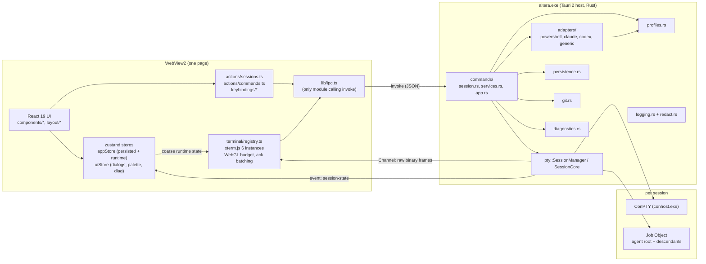

# Altera — Architecture

This document describes what the code does today. File paths are relative to the repo root. Constants are quoted by name so they can be found with a grep.

## Contents

1. [Component overview](#1-component-overview)
2. [Process model](#2-process-model)
3. [Threading model](#3-threading-model)
4. [Terminal output data flow](#4-terminal-output-data-flow)
5. [Input path](#5-input-path)
6. [Session lifecycle](#6-session-lifecycle)
7. [Terminal registry lifecycle (frontend)](#7-terminal-registry-lifecycle-frontend)
8. [State model and restore semantics](#8-state-model-and-restore-semantics)
9. [Claude profiles](#9-claude-profiles)
10. [Agent adapters](#10-agent-adapters)
11. [Persistence](#11-persistence)
12. [Security model](#12-security-model)
13. [Diagnostics and attribution](#13-diagnostics-and-attribution)
14. [Logging](#14-logging)

---

## 1. Component overview



| Module | Responsibility |
|---|---|
| `src-tauri/src/types.rs` | The IPC contract (serde camelCase), mirrored in `src/lib/types.ts`. Change both together. |
| `src-tauri/src/pty/` | ConPTY sessions (`session.rs`), replay ring (`ring.rs`), attachment/pump/flow control (`stream.rs`), Job Objects (`job.rs`), escape-sequence tools (`text.rs`). |
| `src-tauri/src/adapters/` | How to find, launch and resume each agent. Executable discovery and helper-process utilities. |
| `src-tauri/src/profiles.rs` | Claude account profiles (`profiles.json`) and `claude auth status` checks. |
| `src-tauri/src/persistence.rs` | Versioned, atomically written `workspaces.json`. |
| `src-tauri/src/git.rs` | Repo info and `git worktree add` (read-only commands otherwise). |
| `src-tauri/src/diagnostics.rs` | CPU/RAM attribution and the redacted diagnostics bundle. |
| `src-tauri/src/logging.rs`, `redact.rs` | JSON log files and secret redaction. |
| `src/lib/ipc.ts` | Typed wrappers for every Tauri command. The only caller of `invoke`. |
| `src/store/appStore.ts` | `persisted` (saved to `workspaces.json`) and `runtime` (live `SessionInfo` by id). |
| `src/store/uiStore.ts` | Dialogs, palette, toasts, shared diagnostics poll. |
| `src/actions/sessions.ts` | The only place that turns user intent into `session_*` calls. |
| `src/actions/commands.ts` | Command registry used by the palette, keybindings and menus. |
| `src/terminal/registry.ts` | The single owner of xterm.js instances, outside React. |
| `src/layout/*` | Group grid (react-resizable-panels), panes, pane headers. |

---

## 2. Process model

```
altera.exe  (Tauri host: Rust backend, main/UI thread, tokio runtime)
├── msedgewebview2.exe  ×N   (WebView2: browser, renderer, GPU, utility processes; managed by WebView2)
├── conhost.exe              (one per session: system ConPTY host created by CreatePseudoConsole)
└── <session root>           (pwsh.exe / claude.exe / codex.exe / cmd.exe /d /c <shim> / ...)
    └── descendants…         (node, git, MCP servers, tool processes...)
        ── all in one Job Object per session (JOB_OBJECT_LIMIT_KILL_ON_JOB_CLOSE, no breakaway)
```

- **One host process.** `tauri-plugin-single-instance` makes a second launch focus and unminimize the existing window instead of starting a second instance (`src-tauri/src/lib.rs`).
- **WebView2** runs its usual multi-process architecture. All UI and all terminals share one page, which means one renderer process and one GPU process.
- **Per session:**
  - one pseudoconsole (`conhost.exe` with the system ConPTY);
  - the session's root process, assigned right after spawn to its own Job Object created with `JOB_OBJECT_LIMIT_KILL_ON_JOB_CLOSE` and no breakaway flags (`pty/job.rs`). Every descendant stays in the job, so terminating the job (or closing its last handle, including when Altera exits or crashes) kills exactly that session's tree.
- **Processes do not outlive the app.** On `RunEvent::Exit`, `AppCtx::shutdown` → `SessionManager::shutdown_all(1500 ms)`. If the host dies abruptly, the kernel closes the job handles and `KILL_ON_JOB_CLOSE` terminates the trees. Verified on the target machine: no orphaned agent processes after an app restart.
- **Known gap:** portable-pty doesn't spawn with `CREATE_SUSPENDED`. A child that spawns another process before `AssignProcessToJobObject` runs could escape the job. This hasn't been observed with shells or agent CLIs.
- **Short-lived helper processes** (`--version` probes, `claude auth status --json`, `git`) use `CREATE_NO_WINDOW`. They run with closed stdin and a hard timeout (`adapters/process.rs`: `run_with_timeout`).

---

## 3. Threading model

### Rust host

| Thread | Purpose |
|---|---|
| Main (UI) thread | Tauri event loop. **Synchronous** commands run here and must be quick: `state_load`, `state_save`, `profiles_list`, `profile_create`, `profile_update`, `profile_delete`, `session_list`, `diagnostics_snapshot`, `path_info`, `log_frontend`, `app_info`. The `Exit` handler calls `shutdown_all` here. It waits only on per-session condvars, holds no locks and emits no events. |
| Tokio async workers | `async` commands. The hot paths (`session_write`, `session_write_binary`, `session_ack`, `session_resize`, `session_attach`, `session_detach`, `session_stop`) take only short locks and never wait on the child or the frontend. |
| Blocking pool (`spawn_blocking`) | Anything slow: `session_start` (process launch), `agents_detect` (parallel `--version` probes, 10 s timeout each), `profile_check` (15 s timeout), `git_info`, `git_worktree_add` (60 s), and the agent detection inside `diagnostics_export`. |
| `pty-read-<id>` | Blocking 64 KiB reads from the ConPTY output pipe → `Output::ingest`. Never blocks on the frontend. |
| `pty-write-<id>` | Drains the session's input queue into the ConPTY input pipe in 16 KiB chunks. |
| `pty-wait-<id>` | `WaitForSingleObject` on the root process, then runs the exit sequence. |
| `pty-pump-<id>` | One per attachment. Coalesces and sends frames, applies flow control. Parked on a condvar with no timeout while idle. |
| `pty-stop-<id>` | Transient, only during a graceful stop. |
| tracing-appender worker | Non-blocking log writer. Redacts each line before it reaches disk. |

Every per-session thread body runs inside `catch_unwind` (`spawn_guarded`) with drop guards (for example `EofGuard`, `ExitGuard`), so a panic ends only that thread and leaves the session consistent. Release builds use `panic = "unwind"` so this works (`Cargo.toml`). The `session-state` listener is also wrapped, so a failing emit can't take a session thread down.

### Frontend

The frontend is single-threaded JS. The invariant is that **terminal bytes never enter React or zustand state**. Channel messages go straight to `term.write()` in the registry. Panes subscribe with narrow selectors to coarse runtime state (state, pid, exit code), never to output.

---

## 4. Terminal output data flow

```
ConPTY output pipe
   │  pty-read-<id>: read(64 KiB)
   ▼
CprScanner.feed(chunk)  ── counts complete ESC[6n requests (robust to splits)
   │
   ▼
Output::ingest(chunk, cprs)          [short lock, never waits]
   • ring.push(chunk)                bounded ring, absolute u64 offsets (pty/ring.rs)
   • if cprs > 0 and (no view attached OR view paused by flow control):
        reply ESC[1;1R ×cprs via input queue; mark bytes filter_upto
   • wake pump when pending goes 0→>0 or crosses FLUSH_BYTES
   ▼
pty-pump-<id>  (one per attachment, generation-tagged)
   • first frame after attach: RESET
   • flush when pending ≥ FLUSH_BYTES (64 KiB) or FLUSH_DELAY (8 ms) since oldest unsent byte
     (immediately for filtered/replayed bytes and at EOF)
   • frame = [DATA][≤ MAX_FRAME (64 KiB) payload]
   • bytes below filter_upto: filter_queries() strips DSR/DA/DECRQM/XTVERSION/kitty-flags/
     OSC colour queries/DECRQSS/XTGETTCAP (never split a query across chunks)
   • unacked += payload; pause at HIGH_WATER (1 MiB), resume at LOW_WATER (256 KiB)
   • send_off < ring.start (view fell behind):  settle CPRs, restart from
     ring.replay_start_within(len/2), send ONE RESET until data follows, zero the ack window
   ▼
tauri::ipc::Channel<InvokeResponseBody>::send(Raw(frame))   → ArrayBuffer in JS
   ▼
registry.ts channel.onmessage (ignored if the attach generation is stale)
   • DATA  → term.write(payload, () => batcher.add(n))
   • RESET → new AckBatcher (new epoch); term.write("", () => term.reset())  (queued behind pending writes)
   ▼
AckBatcher → ipc.sessionAck(id, n)   flush at ≥ 64 KiB parsed or 30 ms after the last parse
```

Key properties:

- **The child is never paused by the UI.** The reader only appends to the ring. A slow, hidden or detached view makes the pump stop sending, never the reader stop reading. The cost of falling behind is a RESET plus a replay, not backpressure on the agent.
- **Flow control counts DATA payload bytes** (frame length − 1). Acks are sent only after xterm has *parsed* the bytes (the write callback). If `term.write` throws (xterm's hard 50 MB buffer), the bytes are acked anyway so the backend can't stall.
- **CPR invariant** (`pty/stream.rs` header): every `ESC[6n` is answered exactly once. xterm answers when the bytes are delivered live. Rust answers `ESC[1;1R` otherwise: no view attached, view paused, or bytes that were pending when a view detached, was replaced, or fell behind (`settle_undelivered`). This matters because portable-pty always passes `PSEUDOCONSOLE_INHERIT_CURSOR`, and ConPTY can block at startup until the CPR is answered.
- **Replay never injects stale replies.** On attach, `send_off = ring.replay_start()` and `filter_upto = ring.end()`. Everything replayed has its queries stripped, so a newly attached xterm doesn't answer old DA/DSR requests into the child's stdin.
- **Clean replay boundary.** Once the ring has overflowed, replay starts after the first `\n`, so the terminal never starts inside an escape sequence or a UTF-8 code point (`Ring::replay_start`).
- **Ring sizing:** `Settings.buffer_kib` (default 2048, clamped to 256–65,536). Allocation grows geometrically but never beyond the cap. `session_clear_buffer` empties it with monotonic offsets.
- **Plain-text export:** `session_output_text` → `text::strip_ansi`. It removes escapes, normalizes CR/LF, and expands `CSI n C` (ConPTY's cursor-forward in place of runs of spaces) back into spaces.
- A **`session-state`** event (payload `SessionInfo`) is emitted on every state transition and once on the first output byte (used by the no-output watchdog).

---

## 5. Input path

```
keydown ──► window capture listener (keybindings/index.ts)
              └─ bound app command? → preventDefault, runCommand(id)   (never a terminal-critical key)
         ──► xterm customKeyEventHandler (registry.ts installKeyHandler)
              ├─ isAppShortcut → ignored by xterm
              ├─ Ctrl+Shift+C → copy;  Ctrl+C with selection → copy + clear;  Ctrl+C otherwise → ^C to the child
              └─ Ctrl+V / Ctrl+Shift+V → clipboard → term.paste()  (bracketed paste if enabled; native paste suppressed)
         ──► xterm onData(string) ─► splitForWrite (≤ 64 KiB UTF-8, surrogate-safe)
                                     ─► serialized writeChain ─► invoke session_write
             xterm onBinary(string) ─► bytes (charCode & 0xff) ─► invoke session_write_binary
Rust: Session::write → InputHandle::send_user (cap MAX_INPUT_QUEUE = 8 MiB, else "input queue full")
      → mpsc → pty-write-<id> → ConPTY input pipe in 16 KiB chunks
```

- Input and output are independent queues, so Ctrl+C is never stuck behind buffered output.
- Internally generated input (CPR replies, Ctrl+C on stop) goes through `InputMsg::Internal`, which doesn't count against the 8 MiB cap and is never refused.
- Right-click copies if there is a selection and pastes otherwise. When the program has enabled mouse tracking, the right-click goes to the program unless Shift is held.
- Links open only on Ctrl+click and only for `http:`/`https:` URLs.
- Resize: a `ResizeObserver` triggers a fit (once per animation frame plus a 50 ms trailing fit). `session_resize` is sent only when cols/rows change. Rust clamps sizes to 2–1000 cols and 1–500 rows.

---

## 6. Session lifecycle

```
            session_start
                 │
            ┌────▼────┐   launch error (missing exe, bad cwd, spawn failure)
            │Starting │──────────────────────────────► Failed{message}
            └────┬────┘
                 │ process spawned, threads up
            ┌────▼────┐
            │ Running │
            └────┬────┘
   stop (graceful/force) │                 root process exits by itself
            ┌────▼────┐  │
            │Stopping │──┴──────────────► Exited{code}
            └─────────┘
```

**Start** (`commands/session.rs::session_start` → `adapters::resolve_launch` → `SessionCore::start` → `Session::launch`):
1. `resolve_launch` validates the spec:
   - the cwd exists;
   - no NUL in args or env;
   - env names are valid;
   - a generic session has a command.
2. It resolves the executable (explicit command → settings override → adapter discovery) and builds args/env (see §10).
3. `SessionCore::start` is serialized by `start_lock`. A live session with the same id is an error. An exited or failed one is **replaced**, which is how restart works: the previous `Output` is closed and its pumps exit.
4. `Session::launch`:
   1. applies `env_remove` then `env_set` on top of portable-pty's base environment (this process's environment refreshed from the registry);
   2. resolves the program to an absolute path;
   3. opens the pseudoconsole and spawns the process;
   4. drops the slave handle, so the master is the only owner of the pseudoconsole;
   5. assigns the root pid to a new Job Object;
   6. starts the reader, writer and waiter threads, then moves to `Running`.
5. A stop that arrives during launch is honoured as soon as there is something to kill.

**Graceful stop** (`Session::stop(force=false)`): Ctrl+C (`0x03`) → wait `STOP_CTRL_C_GRACE` (2 s) → close the pseudoconsole (sends `CTRL_CLOSE_EVENT`) → wait `STOP_CLOSE_GRACE` (3 s) → `TerminateJobObject`. It returns immediately, and the sequence runs on `pty-stop-<id>`.

**Force stop** (`force=true`): `TerminateJobObject` on the whole tree. If that fails, it falls back to `TerminateProcess` on the root.

**Exit detection** (`pty-wait-<id>`):
1. `child.wait()` returns, and the state becomes `Exited{code}`.
2. Wait until ConPTY output has been quiet for `DRAIN_IDLE` (100 ms), but no longer than `DRAIN_MAX` (1.5 s). Then close the pseudoconsole, never from the reader thread, because before Win11 24H2 `ClosePseudoConsole` blocks until the output is drained.
3. Descendants still in the job get `ORPHAN_GRACE` (2 s), and then the job is terminated.
4. Wait up to `READER_EOF_WAIT` (3 s) for the reader to reach EOF.

The frontend writes a dim `[process exited with code N]` notice and turns off any mouse-reporting modes a crashed TUI left on.

**App exit** (`shutdown_all(1500 ms)`): all live sessions get Ctrl+C → wait until half the timeout → release the remaining pseudoconsoles → wait until the deadline → terminate the remaining jobs → 500 ms grace. Events are suppressed during shutdown (`quiet` flag) because the webview may already be gone.

**Restart** (`actions/sessions.ts::restartSession`): graceful stop → wait up to 6 s → force if needed → clear the xterm buffer → `startSession` with the chosen resume mode (`continue` or `none`). The registry sees a new `startedAt` and attaches a fresh channel.

**Close pane** (`closeSession`): stop (graceful, then force after 4 s) → `session_remove` (refused while live) → drop runtime and metadata. The registry disposes the terminal when the session's metadata disappears.

**Same-agent launch staggering** (`LAUNCH_GAP_MS`): claude 350 ms, codex 600 ms, PowerShell and generic 0 ms. Different agent kinds still start in parallel. This mitigates the Codex 0.162 issue where one of six simultaneous launches produced no output.

**No-output watchdog** (`layout/Pane.tsx`, `SILENT_MS = 12000`): a session that is `running` with `bytesOut === 0` for 12 s shows "No output for 12 s — the program may be stuck · Restart".

---

## 7. Terminal registry lifecycle (frontend)

`src/terminal/registry.ts` is the only owner of xterm.js instances. React's `<TerminalView>` is an empty container that subscribes to nothing.

| Phase | What happens |
|---|---|
| **Lazy creation** | An entry is created the first time a `<TerminalView>` for the session mounts: `Terminal`, plus the Fit, Search, Unicode11 and WebLinks addons, input handlers, and a persistent host `<div>`. `term.open()` runs once, when the container first has a non-zero size. Attaching the output channel starts immediately. |
| **Attach** | `ipc.sessionAttach(id, Channel)` runs on creation and on every (re)start (a new `startedAt`). Each attach bumps a generation, and messages from stale channels are ignored. Attaching retries up to 5 times (300 ms × n) while the store says the session is live. After a webview reload, `boot()` re-syncs `session_list`, and the registry adopts the backend's `startedAt`. |
| **Parking / reparenting** | Unmount moves the host `<div>` into a hidden parking container (`display:none`). Mount moves it back. The terminal state is preserved, and xterm keeps **parsing** output while parked (IntersectionObserver pauses rendering only). Inactive groups are `display:none` too. |
| **WebGL budget** | `MAX_WEBGL = 12` (Chromium's limit is 16 per renderer process). Only *shown* terminals (opened, mounted, visible, sized) are candidates. `allocateWebgl` is stable: terminals that already hold a context keep it, and free slots go by priority (focused terminal first, then most recently shown). A terminal that stops being shown keeps its context for `WEBGL_RELEASE_GRACE_MS` (400 ms), so layout reshuffles don't thrash. Terminals over the budget render with DOM. Setting `renderer: "dom"` disables WebGL entirely. |
| **Context loss** | The addon is disposed and the terminal switches to DOM. WebGL is retried after `WEBGL_RETRY_MS` (3 s) while visible. After `WEBGL_MAX_LOSSES` (3) the terminal stays on DOM. The GPU probe's own context is released immediately via `WEBGL_lose_context`. |
| **Hidden view** | "Hide view" (pane header / inspector) calls `disposeTerminal` and `session_detach`. The xterm instance and its scrollback are freed, while Rust keeps the process running and the bounded ring filling. "Show view" re-creates the entry, attaches, and gets RESET plus a replay of the ring. Scrollback older than the ring is gone. |
| **Dispose** | `disposeTerminal` runs when the view is hidden or the session's metadata leaves the store (pane closed, group or workspace deleted). It detaches the channel (the detach is awaited before any re-attach), disposes the addons and the terminal, and removes the element. |
| **Settings** | Scrollback and cursor blink apply immediately. Font changes apply only to shown terminals, because metrics can only be measured while visible. Parked terminals are marked dirty and pick the change up when shown. |

Debug hooks: `window.__alteraTerminals.list()/text(id)` and `window.__alteraForceContextLoss(id?)`. The e2e scripts use them.

---

## 8. State model and restore semantics

```
Application (PersistedState v1: settings, activeWorkspaceId)
└── Workspace (id, name, projectDir?, activeGroupId, createdAt)
    └── Group (id, name, layout {preset grid|columns|rows, maximized?, sizes by signature}, sessionIds[] ordered)
        └── Session → SessionMeta (persisted)  +  SessionInfo (runtime, from Rust)
```

| Persisted (`workspaces.json`) | Runtime only |
|---|---|
| `SessionMeta`: id, name, agent, cwd, profileId, command, args, env (secret-looking keys stripped), `autoStart`, `resumeOnRestore`, `agentSessionId` (pinned Claude conversation id), worktree, createdAt, lastExitCode | `SessionInfo`: pid, state, startedAt/endedAt, `bytesOut`, redacted `commandDisplay` |
| Workspaces, groups, layout, pane order, split sizes | The Rust ring buffer, xterm scrollback, focus, hidden views, dialogs |
| Settings (terminal, renderer, agent paths, keybindings, UI toggles) | Profile auth status (computed on demand) |

**Three separate things happen on restore:**

1. **Layout restore** always happens. Workspaces, groups, panes and sizes come back from `workspaces.json`.
2. **Process reconnection never happens.** Processes don't survive app exit: they are stopped on exit, and the Job Objects kill them if the host crashes. Every restored pane gets a **new** process.
3. **AI conversation resume** is per session, driven by `autoStart` and `resumeOnRestore` (`restoreSessions` in `actions/sessions.ts`, 120 ms between launches, on top of the same-agent gaps):

   | Agent | `resumeOnRestore: continue` (default for agents) | `none` |
   |---|---|---|
   | Claude | Resumes **the pane's own pinned conversation**. The frontend sends `Session{id: agentSessionId}`. Rust checks whether `<config root>/projects/*/<id>.jsonl` exists (listing only, never opened). If it does, `--resume <id>`. If not (never written, or another profile), `--session-id <id>` starts a fresh conversation pinned to the same id. | New random UUID → `--session-id <uuid>`, stored as `agentSessionId`. |
   | Codex | `codex resume --last` (filtered by cwd). **If more than one restored Codex pane shares the same cwd** (case-insensitive), each of them gets `{mode:"pick"}` → `codex resume` (Codex's interactive picker) instead. Otherwise they would all resume the same conversation, because Codex can't pin an id up front. This decision is made in the frontend. | Fresh `codex`. |
   | PowerShell / generic | Fresh process (no resume). | Fresh process. |

Verified on the target machine: workspace restore re-launched 10 sessions, and the Claude panes resumed with their pinned ids (falling back to `--session-id` when no transcript existed).

Duplicating a workspace copies the configuration (groups and session definitions) but never the processes. Bench mode never persists anything.

---

## 9. Claude profiles

A profile is a name, an optional `CLAUDE_CONFIG_DIR` and a badge colour, stored in `profiles.json` (version 1, `profiles.rs`).

- **Default profile** (`config_dir: None`) means Claude's default location (`%USERPROFILE%\.claude`). Sessions launched with it have `CLAUDE_CONFIG_DIR` explicitly **removed**, because the app may have inherited one, and leaking it would run the "default" profile under another account.
- **Other profiles** set `CLAUDE_CONFIG_DIR=<dir>`. A missing directory fails the launch ("Profile directory missing").
- **Seeding:** on first run, `profiles.json` is seeded with Default plus every `~/.claude-*` sibling that looks like a Claude config dir. That means it has `.credentials.json`, or `settings.json` together with `.claude.json` or `projects/`. These are existence checks by filename only.
- **Validation:** names must be unique. A directory must be absolute and not used by another profile, and only one profile can be Claude's default location. A non-existent directory is created empty. Existing directories are never modified. **Delete removes only the entry**; the directory is never touched.
- **Identity isolation:** two layers of environment stripping.
  1. For **every** session (`adapters::inherited_agent_session_vars`): variables that belong to a *parent* Claude Code session are removed: `CLAUDECODE`, `CLAUDE_PID`, `CLAUDE_EFFORT`, `CLAUDE_CODE_ENTRYPOINT`, `CLAUDE_CODE_EXECPATH`, `CLAUDE_CODE_SSE_PORT`, `CLAUDE_CODE_CHILD_SESSION`, and everything prefixed `CLAUDE_CODE_SESSION_` or `CLAUDE_CODE_MESSAGING_`. `CLAUDE_CONFIG_DIR` is deliberately excluded here. Without this, launching Altera from inside Claude Code made nested `claude` report "Transcript saving is off".
  2. For **Claude** sessions (`CLAUDE_IDENTITY_ENV`): `ANTHROPIC_API_KEY`, `ANTHROPIC_AUTH_TOKEN`, `CLAUDE_CODE_OAUTH_TOKEN` and `ANTHROPIC_PROFILE` are removed. They outrank the per-config-dir login, so leaving them in would make every profile the same identity.

  A user can deliberately re-add any variable through the session's `env`, which is applied last. Secret-looking keys are not persisted, though (§11).
- **Auth check** (`profile_check` → `check_status`) runs `claude auth status --json` with the profile's environment. It uses `%TEMP%` as the cwd, so no project settings are picked up, and runs only for existing directories, because the command creates files otherwise. It parses `loggedIn`, `authMethod` and `email`. The e-mail goes to the UI only and is never logged or persisted. Credential files are never read: the cheap status only checks that `.credentials.json` *exists*.
- **Signing in** happens inside Claude Code itself (start a session with the profile and run `/login`). Altera never copies or writes credentials.
- **Concurrency warning:** the New Session dialog warns when a live session already uses the profile, or when several sessions are being created with it. Concurrent OAuth refreshes in one profile can force a re-login (Claude Code #91708).

Verified on the target machine: Default, account1 and account2 each showed their own account and model in concurrent sessions, and `claude auth status --json` reported all three logged in (`authMethod: claude.ai`).

---

## 10. Agent adapters

```rust
pub trait AgentAdapter: Send + Sync {
    fn kind(&self) -> AgentKind;
    fn display_name(&self) -> &'static str;
    fn capabilities(&self) -> Capabilities;               // supports_resume, supports_profiles
    fn settings_override<'s>(&self, s: &'s Settings) -> Option<&'s str> { None }
    fn discover(&self) -> Option<Executable>;              // None = not installed
    fn version_args(&self, exe: &Executable) -> Option<Vec<String>>;  // default ["--version"]
    fn configure(&self, ctx: &LaunchContext<'_>, exe: &Executable, plan: &mut PlanBuilder) -> AppResult<()>;
}
pub static ADAPTERS: &[&dyn AgentAdapter] = &[&PowerShellAdapter, &ClaudeAdapter, &CodexAdapter, &GenericAdapter];
```

`resolve_launch` builds the plan in this order:
1. Base environment: `TERM=xterm-256color`, `COLORTERM=truecolor`, `TERM_PROGRAM=Altera`, `TERM_PROGRAM_VERSION`. Remove `WT_SESSION` and `WT_PROFILE_ID`.
2. Strip the inherited parent-agent variables (§9).
3. Run the adapter's `configure` (resume flags, profile env).
4. Append the user's args.
5. Apply the user's env last.

`PlanBuilder` compares environment keys case-insensitively, the Windows rule, and a later set cancels an earlier remove of the same key and vice versa.

| Adapter | Discovery | Launch specifics |
|---|---|---|
| PowerShell | `pwsh` on PATH → `%ProgramFiles%\PowerShell\7\pwsh.exe` → `powershell` → `System32\WindowsPowerShell\v1.0\powershell.exe` | `-NoLogo`. 5.1 version probe via `$PSVersionTable`. |
| Claude Code | `%USERPROFILE%\.local\bin\claude.exe` (native) → PATH | Profile env (§9), `CLAUDE_CODE_ALT_SCREEN_FULL_REPAINT=1`, resume flags (§8). |
| Codex | Native exe on PATH → `%LOCALAPPDATA%\Programs\OpenAI\Codex\bin\codex.exe` → npm `.cmd` shim | Alt screen left on. `resume --last` / `resume` / `resume <id>`. |
| Generic | none (`command` required) | Bare names resolved on PATH. |

**npm shims** (`adapters/discovery.rs`): a ConPTY child must be a real PE file, so discovery prefers a native `.exe`, either a sibling or the target parsed from the generated `.cmd` shim text. If only a `.cmd`/`.bat` exists, it runs as `%SystemRoot%\System32\cmd.exe /d /c <shim> …`. That path uses `SystemRoot`, not the user-controlled `COMSPEC`, and `/d` skips AutoRun. Arguments containing cmd metacharacters are rejected in that mode (`validate_cmd_args`).

Conversation ids passed to agents must be 8–64 characters of hex digits and dashes (`validate_session_id`).

**Adding an agent:**
1. Add an `AgentKind` variant in `types.rs` and `src/lib/types.ts`.
2. Add `src-tauri/src/adapters/<name>.rs` implementing `AgentAdapter`.
3. Register it in `ADAPTERS`. `detect` and `resolve_launch` pick it up automatically.
4. Frontend: add the label and glyph (`AGENT_LABEL`, icons), a `LAUNCH_GAP_MS` entry, and a `defaultResume` rule if it supports resume. Add an `agentPaths` setting if it needs an override.
5. Add tests in `adapters/tests.rs`.

---

## 11. Persistence

`workspaces.json` (`persistence.rs`) and `profiles.json` (`profiles.rs`) live under `%APPDATA%\ai.altera.workspace`.

- **Versioned:** `STATE_VERSION = 1`. `migrate()` upgrades a missing/0 version to v1 (same shape), and future steps slot in as `if from_version < N`. A file with a **newer** version is loaded best-effort, and the store becomes **read-only**: `state_save` returns an error explaining the file came from a newer Altera, so data this build doesn't understand is never overwritten. An unreadable file (locked, permissions) also makes the store read-only.
- **Lenient load:** if strict deserialization fails, valid entries are kept individually and invalid ones are dropped. When that happens, a copy of the original is preserved first as `workspaces.corrupt-<timestamp>.json`. A file that isn't valid JSON, or has the wrong top-level shape, is *renamed* to that name, and the app starts with defaults. Nothing is silently deleted.
- **Sanitize (on load and save):**
  - deduplicates ids;
  - drops dangling pane references and orphan sessions (sessions in no group), so each session is in at most one group;
  - fixes the active workspace/group if it is dangling;
  - clamps settings (scrollback 100–200,000, buffer 256–65,536 KiB, font size 8–32, line height 1–2);
  - **strips secret-looking env vars** from sessions (`redact::is_secret_key`).

  `check_paths` rejects NUL characters in paths on save.
- **Atomic write:** write `<file>.tmp` → `fsync` → copy the previous file to `<file>.bak` if it parses as JSON (one backup kept) → rename over the original, retrying up to 4 times on `PermissionDenied` (antivirus or indexers). Writers are serialized.
- **Frontend:** the `persisted` slice is saved with a 400 ms debounce and flushed on `beforeunload`.

---

## 12. Security model

- **No HTTP server.** The UI talks to Rust only through Tauri IPC. In development, Vite serves the frontend on `localhost:1420`; release builds load bundled assets.
- **CSP** (`src-tauri/tauri.conf.json`), verbatim:
  `default-src 'self'; script-src 'self'; style-src 'self' 'unsafe-inline'; img-src 'self' data: blob:; font-src 'self' data:; connect-src ipc: http://ipc.localhost`
- **Capabilities** (`src-tauri/capabilities/default.json`), main window only: `core:default`, `opener:default`, `dialog:default`, `clipboard-manager:allow-write-text`, `clipboard-manager:allow-read-text`.
- **No credential reads.** Credentials are checked for *existence* by filename only. Claude transcripts are checked by listing only. Auth state comes from `claude auth status --json`, whose output contains no tokens. The only third-party files whose text is read are npm-generated `.cmd` launcher shims (to find the real `.exe`), and `git`/agent `--version` output.
- **No secrets in arguments or on disk.** Identity variables are stripped from agent environments. Secret-looking env keys are never persisted. Command lines shown in the UI and logs are redacted (`display_command`).
- **Redaction** (`redact.rs`) is applied at three sinks:
  1. every log line, on the log worker thread;
  2. every `AppError` message sent to the UI;
  3. the diagnostics bundle, which additionally replaces the home directory with `~`.

  Patterns cover Anthropic/OpenAI keys, Bearer tokens, GitHub tokens, AWS key ids, JWTs, `key=value`/JSON pairs whose key contains a secret word, and secret-named CLI flags. Account e-mails are never logged.
- **Terminal output is untrusted:**
  - It is rendered only by xterm (never as HTML).
  - Links open only on Ctrl+click and only for http/https (`allowNonHttpProtocols: false`).
  - Replayed output has terminal queries stripped, so it can't inject replies into the child.
  - On exit, mouse-reporting modes are reset.
- **Input validation at the boundary:** NUL checks on cwd, args and env; env name validity; conversation-id format; branch-name check before `git worktree add`; cmd-shim metacharacter rejection.
- **Git:** only read-only commands plus `worktree add`, with `GIT_TERMINAL_PROMPT=0`, `GIT_PAGER=cat` and `GIT_OPTIONAL_LOCKS=0`. The UI shows the exact command and asks for confirmation before creating a worktree.
- **No telemetry.** The app makes no network calls of its own. Diagnostics bundles are written locally and only shared if the user sends them.

---

## 13. Diagnostics and attribution

`diagnostics_snapshot` (`diagnostics.rs`) attributes resources to three buckets:

| Bucket | Processes |
|---|---|
| `host` | `altera.exe` only (`std::process::id()`). |
| `webview` | Descendants of the host whose image name is `msedgewebview2.exe`. |
| `sessions[]` / `sessionsTotal` | For each live session, the tree rooted at its root pid. The total counts each pid once. |

- **Sampling:** one Toolhelp process snapshot gives pid, parent pid and exe name. Then `OpenProcess` + `GetProcessTimes` + `GetProcessMemoryInfo` run only for the reported processes. The code comment records ~6–7 ms for a snapshot of ~400 processes in a release build. `sysinfo` is used only for system memory, core count and CPU brand, because its per-process refresh would need a second full Toolhelp walk.
- **CPU%** = CPU-time delta / wall-time delta between snapshots, as a percent of one logical core summed over processes (the UI divides by logical cores for Task Manager-style numbers). A process seen for the first time reports 0. PID reuse is guarded by creation time.
- **Memory** = working set.
- **Polling** happens every 2 s, shared by the status bar, inspector and diagnostics panel, and only while one of them wants it **and** the window is visible.
- **Attribution gap:** the system ConPTY host (`conhost.exe`) is created by `CreatePseudoConsole` in the context of `altera.exe`. It is not a descendant of the session root and not in the session's Job, so the in-app snapshot leaves it out of all three buckets. `scripts/bench/sample.ps1` counts it separately as "console". This follows from reading the code and the ConPTY process model, and has not been measured.
- **Export** (`diagnostics_export`) writes `diagnostics/altera-diagnostics-<timestamp>.json`. It contains:
  - app and OS info, CPU, memory;
  - the snapshot and agent detection results;
  - profile *names and existence flags only*;
  - settings;
  - workspace/session counts by agent;
  - frontend renderer status and UI counts;
  - the last 300 log lines.

  Everything is redacted and the home directory is replaced with `~`.

---

## 14. Logging

- JSON lines go to `%APPDATA%\ai.altera.workspace\logs\altera.YYYY-MM-DD.log`. Files rotate daily, and at most 7 are kept (`MAX_LOG_FILES`).
- The default level is `info`. `ALTERA_LOG` takes standard `EnvFilter` syntax, for example `ALTERA_LOG=debug,altera_lib::pty=trace`.
- Debug builds also log human-readable, redacted lines to stdout.
- Frontend messages arrive through `log_frontend` (redacted, target `frontend`).
